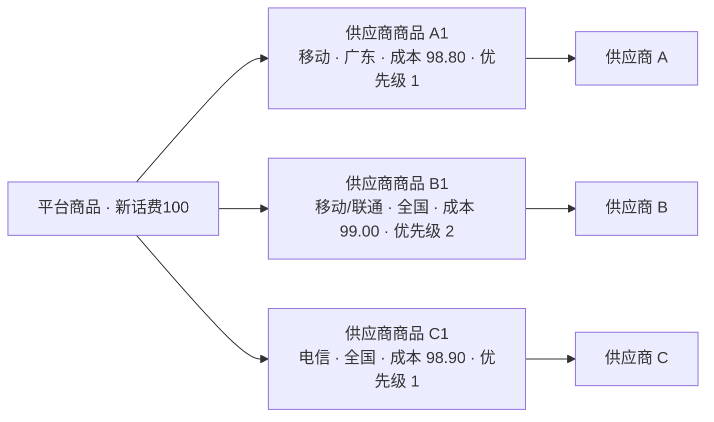
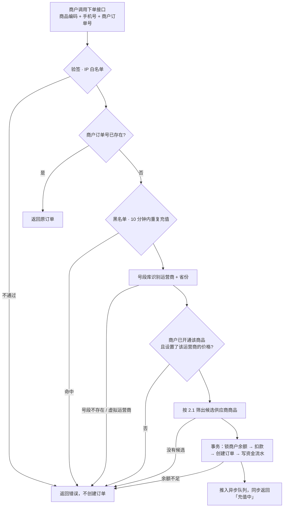
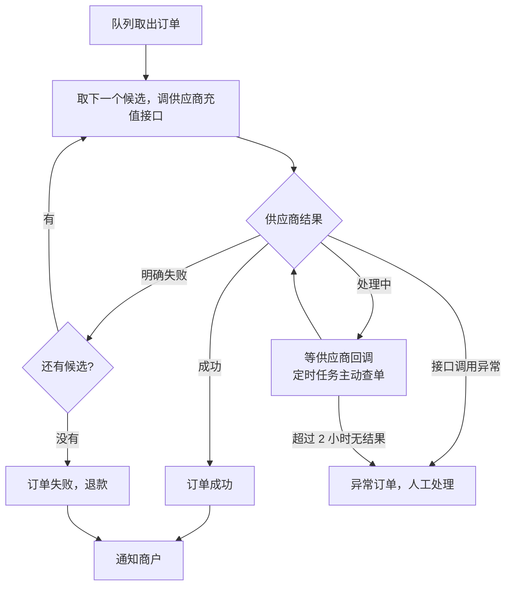
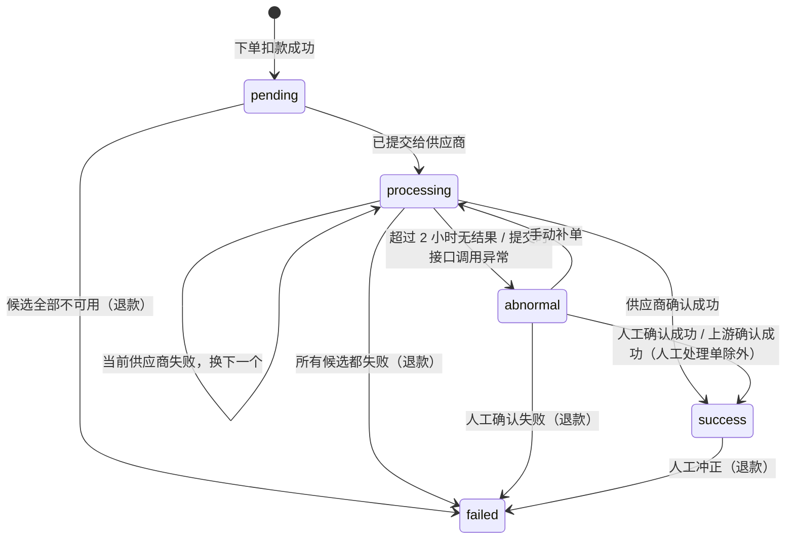
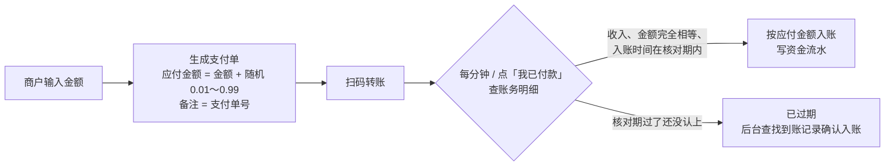
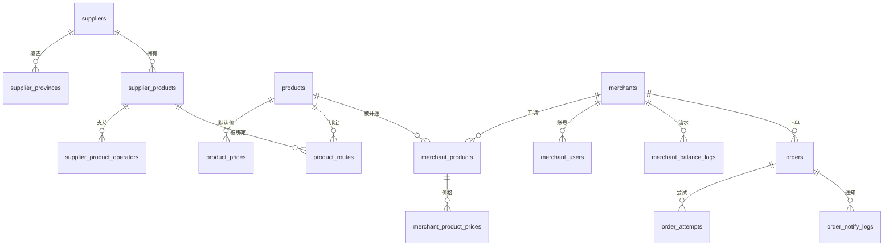

# phoneBill 话费充值平台 · 项目文档

> 最后更新：2026-10-06。需求已基本确定，未定事项见第 10 章。

## 1. 项目概述

phoneBill 是一个话费充值平台。平台自己不直接充话费，而是接入多家**供应商**的充值接口：

1. **商户**通过 API 提交充值订单，平台从商户的**预存余额**里扣款；
2. 平台按手机号识别**运营商**和**省份**，从商品绑定的供应商商品里挑出合适的去充值；
3. 拿到结果后通知商户；失败的订单退款。

### 1.1 范围

| 本期做 | 本期不做 |
|---|---|
| 话费快充 | 慢充、流量包等其他品类 |
| 移动、联通、电信、广电号码 | 虚拟运营商号码（170/171/162/165/167 等） |
| 中国大陆 11 位手机号 | 携号转网的准确识别（接受误差，见 5.1） |
| 商户 API 下单、预存余额扣款 | C 端用户下单、在线支付、商户在线充值 |
| 平台管理后台、商户后台（只读，可自己改 IP 白名单、重置密钥） | 商户在后台手动下单 |

### 1.2 角色与端

| 角色 | 使用的端 | 能做什么 |
|---|---|---|
| 平台管理员 | 平台管理后台（`web/`，已有基础） | 管理供应商、商品、商户、订单、风控 |
| 商户 | 商户后台（新增，独立前端项目 `merchant-web/`） | 只读：订单记录、资金流水、订单状态；自己改 IP 白名单、重置密钥 |
| 商户的系统 | 开放接口 `/open/v1`（新增，接入文档 [api.md](api.md)） | 下单、查单、查余额、查商品，接收结果通知 |
| 供应商 | 供应商的接口 | 平台调它充值、查单；它回调平台告知结果 |

### 1.3 技术基础

Hyperf 3.1 + PHP 8.4 + Swoole，Vue 3 + TypeScript + Element Plus。已有：管理员登录（JWT）、RBAC 权限、操作日志、定时任务进程、异步队列进程。新业务按 `Controller → Service → Dao → Model` 分层添加，编码规范见 `.claude/skills/hyperf-conventions/SKILL.md`。

## 2. 业务规则

本章把所有已确定的规则集中在一起，后面各章按这些规则展开。

### 2.1 商品与选路

- **平台商品**按面值建，一个商品覆盖多个运营商，例如「新话费100」。
- 平台商品绑定多个**供应商商品**（面值必须相同），每个绑定有优先级。
- 供应商商品可以支持多个运营商；**供应商商品**设置覆盖的省份（可选「全国」）。同一个供应商的不同商品可以覆盖不同省份。
- 下单时，候选供应商商品必须同时满足：
    1. 支持该号码的运营商；
    2. 供应商商品覆盖该号码的省份；
    3. 供应商、供应商商品都是启用状态；
    4. 对应的通道没有在维护中。
- 候选按**优先级**排序，优先级相同时**成本低的在前**；依次尝试，直到成功。
- 一个候选都没有时，**直接拒绝下单，不扣款**。例如商品只绑定了只做广东的供应商 A，非广东号码下单就被拒绝。



上图中：广东移动号码 → 候选 A1、B1，先走 A1；湖南移动 → 只有 B1；湖南电信 → 只有 C1；任何地区的联通 → 只有 B1。

### 2.2 价格

- 价格由「**商户 + 商品 + 运营商**」三者确定。例如商户甲买「新话费100」：移动 99.50、电信 99.80。
- 商户必须先**开通**商品才能下单；开通的商品里，没有设置某个运营商的价格，该运营商的号码就不能下单。
- 平台商品上按运营商设置**默认售价**，只用来在开通时带出初始价格，开通后可以改。
- 价格低于成本价时后台提示，不拦截。
- 改价只影响之后的订单；订单记录下单时的价格。

### 2.3 号码

- 只支持中国大陆 11 位手机号。
- 运营商和省份按号段库（前 7 位）识别；号段不存在或属于虚拟运营商时拒绝下单。
- 号段库来自 `recharge_phone_prefix_info` 表的导出文件（51.7 万个号段），用 `segment:import` 导入，按号段覆盖，可重复执行；2026-10-22 用 `t_sys_phone.xlsx` 以 `--only-new` 补了 3755 个新号段（共 52.1 万）。
- 162 / 165 / 167 / 170 / 171 是虚拟运营商专用号段：不管数据里标的运营商是什么，一律标为虚拟运营商，所属运营商按号段分配规则判断（数据源对这几个号段的标注不可靠）。

### 2.4 资金

- 商户预存余额。商户线下打款，管理员在后台手动加款（也可以手动扣款），必须填备注。
- 下单成功即扣款；订单最终失败时退回。每一笔余额变动都写资金流水。
- **授信额度**：每个商户可以设一个授信额度（默认 0，即不能负数）。**可用额度 = 余额 + 授信额度**，扣款时只要扣完余额不低于「负的授信额度」就允许，余额可以是负数；加款（线下打款审核、支付宝转账、后台加款）照常加，负数自然变少，不单独做还款。下单、后台手动扣款都受这个限制；只有订单「失败改成功」重新扣款不受限制（钱已经花在供应商那边，拦住账就对不上），可能扣到超出授信。授信在商户列表里设（`merchant.credit`），金额 0 ~ 1000 万、最多两位小数，只记操作日志不写资金流水；调低到比当前欠款还少也允许，已有欠款不动，还到授信线以上之前不能再下单。
- 冲正（成功订单事后被供应商撤销）：管理员手动改为失败并退款，需单独权限，必须填原因。

### 2.5 订单与风控

- 商户订单号在商户内唯一；重复提交时返回原订单，不重复扣款。失败订单要重下必须换新单号。
- 同一手机号、同一面值，**10 分钟**内只允许一笔进行中的订单。
- 号码在黑名单里时拒绝下单。
- 调供应商超时或返回「处理中」时**不能当失败**，以回调或查单结果为准。
- 下单后 **2 小时**仍无结果的订单转为异常订单，人工处理，**不自动退款**。
- 提交给供应商时**接口调用异常**（连不上、连接超时、等响应超时、HTTPS 握手失败、域名解析失败等）的订单**立即**转异常订单，并标为**人工处理单**：上游可能已经建单（实测商腾连接超时的单照样建了），换下一家可能重复充值。
    - 之后上游的回调、查单结果**只记录**在提交记录里，不改订单状态、不通知商户；
    - 人工「置为成功 / 置为失败并退款」后也**不自动通知**；商户查单一律看到 `processing`，直到人工「手动回调」，查单和回调才同时给出结果；
    - 确认上游没有充上的，可以「手动补单」重新提交（同一笔订单，不重复扣款），补单后按正常流程自动处理。
- 超过 2 小时转来的异常订单不是人工处理单：上游后来明确成功的自动改为成功并通知商户；明确失败的保持异常，人工置为失败并退款。
- **手动回调**：所有订单都可以，推商户当前看到的状态（没出结果、人工处理单没手动回调过的都是 `processing`）。每次开新一轮通知（`orders.notify_round` 加 1），之前排队的通知（含自动重试）作废。
    - 成功 / 失败的订单手动回调后记「已手动回调」（`manual_notified_at`）：之后上游再来的结果只记录、不改订单、不推给商户；和订单结果矛盾时记 error 日志，订单详情标红提醒核对资金。
    - 没出结果的订单手动回调只推 `processing`，不记「已手动回调」，后续照常自动处理，出结果后自动通知（人工处理单仍要人工置为成功 / 失败后再手动回调）。

### 2.6 可配置参数

| 参数 | 默认值 |
|---|---|
| 重复充值拦截时间窗口 | 10 分钟 |
| 订单超时转人工 | 2 小时 |
| 提交后开始主动查单 | 5 分钟后，之后每 5 分钟一次 |
| 通知商户的重试间隔 | 1、5、15、30、60 分钟，最多 5 次 |
| 开放接口签名有效期 | 5 分钟 |

## 3. 业务流程

### 3.1 下单



### 3.2 充值与结果处理



并发控制：扣款和退款在事务里 `lockForUpdate()` 锁商户行，锁内重新读余额再判断；订单状态更新带条件 `where status = 预期状态`，影响行数为 1 才算成功，保证回调、查单、人工操作同时到达时只生效一次。

### 3.3 订单状态



| 状态 | 含义 | 商户看到的 |
|---|---|---|
| `pending` | 已扣款，还没提交给供应商 | 充值中 |
| `processing` | 已提交，等待结果 | 充值中 |
| `abnormal` | 超时无结果，等人工处理 | 充值中 |
| `success` | 充值成功 | 成功 |
| `failed` | 充值失败，余额已退回 | 失败 |

## 4. 平台管理后台

### 4.1 菜单

| 菜单组 | 页面 | 阶段 |
|---|---|---|
| 商品中心 | 供应商、供应商商品、商品分类、平台商品、商品统计 | 一 / 四（商品统计） |
| 风控 | 号段查询、号码黑名单、通道维护 | 一（号段查询） / 二 |
| 商户中心 | 商户、商户商品与价格、资金流水、加款申请（含付款账号审核）、收款配置 | 二 |
| 订单中心 | 订单列表、异常订单 | 二 |
| 系统管理 | 管理员、角色权限、操作日志（已有）、系统配置（系统名称、回调域名、下单设置、支付宝转账加款账户、图片存储） | — |

### 4.2 供应商

- 字段：名称、编码、对接驱动、接口参数、状态、备注。覆盖省份在供应商商品上设置。
- **系统名称**：「系统管理 - 系统配置 - 基本设置」里填（最多 30 个字，存 `system_settings` 的 `site.name`），显示在管理后台左上角、登录页和浏览器标题；留空用打包时的 `VITE_APP_TITLE`。登录页要显示，所以 `GET /admin/settings/public` 不用登录。
- **回调地址自动生成**：`回调域名/notify/supplier/{供应商编码}`，回调域名在「系统管理 - 系统配置」填一次（存 `system_settings` 的 `notify.base_url`），各驱动的接口参数里不再有回调地址；列表显示生成的地址，可复制给供应商。还没配回调域名时，沿用以前手填存下的地址（`SupplierGateway::driverConfig()`）。
- 接口参数按所选驱动动态渲染（不同供应商要填的不一样）；密钥加密存库，列表和日志里打码。
- 操作：新增、编辑、启用/停用。
- **余额**：列表打开后逐个实时调供应商的余额接口（同时最多 3 个），显示金额；驱动不支持显示「不支持」，上游出错显示「查询失败」（鼠标移上去看原因），有「刷新余额」按钮（`GET /admin/suppliers/{id}/balance`）。每个供应商的结果（含出错）后端缓存 30 秒，30 秒内重复查直接用上次的结果，不再调上游（炫捷 30 秒只能查一次）；后台改了供应商的驱动或接口参数会清掉缓存。
- 停用后不再参与选路，历史订单照常可查。

### 4.3 供应商商品

- 字段：所属供应商、名称、支持的运营商（多选：移动 / 联通 / 电信 / 广电）、覆盖省份（多选，可选「全国」，必填）、面值、成本价、供应商侧商品编码、状态（上架/下架）。
- 列表可按供应商、运营商、覆盖省份（含「全国」的也算）、面值、状态筛选。

### 4.4 平台商品

- 字段：商品分类、商品编码（商户下单用）、名称、面值、状态。
- **商品编码自动生成**：新建时按面值生成 `HF{面值}-{序号}`（如 `HF100-001`，同面值按已有最大序号递增，至少 3 位），建好后不能改；两人同时建同面值撞号时自动换下一个序号重试。
- 商品分类：在「商品中心 - 商品分类」里维护（名称唯一、排序、备注），只给平台商品用，供应商商品不分类。新建、编辑平台商品时必须选；上线前建的老商品没有分类，列表显示「未分类」，编辑时补上。还有平台商品在用的分类不能删除。列表可按分类筛选。权限跟平台商品一样（`product.view` / `product.manage`）。
- 默认售价：按运营商分别填写。
- 绑定供应商商品：只能选面值相同的，可以多选（跨运营商、跨供应商），每个设优先级（数字越小越先用）。选择时三级联动：先选供应商 → 再选运营商 → 最后选商品，商品选项写清「商品名称 — 成本价 — 面值 — 运营商 — 省份」并标出已下架 / 供应商已停用；选中即加入绑定表，已绑定的不再出现。
- 编辑页自动汇总「覆盖运营商」（由绑定的供应商商品得出），方便发现漏配的运营商。
- 某个运营商的默认售价低于该运营商下绑定的成本价时提示。
- 列表显示「昨日成功率」「昨日平均耗时」（各运营商合起来），明细看商品统计。

### 4.4.1 商品统计

- 每天凌晨 3 点汇总前一天（`StatsCrontab`），按「商品 + 运营商」一行存进 `product_daily_stats`，保留历史；人工处理完异常订单后可以用 `stats:product-daily` 重算。
- 订单按**下单时间**归到当天，不管几点完成。
- 成功率 = 成功 ÷（成功 + 失败），百分比截断到两位小数；还在处理中、异常的单记为「未出结果」，不进分母。
- 耗时 = 成功订单从下单受理到成功（`finished_at - created_at`）：平均值、中位数、90% 的单在多少秒内到账。
- 页面按日期范围（默认最近 7 天，到昨天）、商品、运营商筛选，顶部显示筛选范围内的合计。

### 4.5 风控

- **号段查询**：输入手机号，显示运营商、省份、城市、是否虚拟运营商，以及每个商品下会命中哪些候选供应商商品（排查选路用）。
- **号码黑名单**：新增、删除，带原因。
- **通道维护**：按「供应商」或「供应商 + 运营商 + 省份」临时关闭，设开始和结束时间，到时自动恢复。

### 4.6 商户中心

- **商户**：名称、联系人、电话、状态、AppKey / AppSecret（可重置）、回调地址、IP 白名单；管理商户后台登录账号（可多个，创建、重置密码、启停）。
- **商户商品与价格**：为商户开通商品，按运营商设置价格（开通时带出默认售价）。
- **余额调整**：加款/扣款，必须填备注，记录操作人。扣款不能超出授信额度（见 2.4）。
- **授信额度**（`merchant.credit`）：商户列表「授信」设置，列表的余额列在有授信时显示授信和可用额度，负数余额标红。
- **资金流水**：所有商户的余额变动，显示关联订单的手机号；可按平台订单号（不限日期）、商户、类型、时间筛选。

### 4.6.1 加款申请与收款配置

商户打款给平台后在商户后台提交加款申请，平台核对到账后审核入账，替代线下沟通后人工「余额调整」。


- **账户类型**：收款账户、付款账号都只支持**支付宝**和**对公账户**。对公账号只能是 6~32 位数字（空格自动去掉），开户行必填；支付宝填实名和账号（手机号或邮箱）。
- **收款配置**（`funding.config`）：平台的收款账户，新增、编辑、启用 / 停用（不提供删除）。分配有两个入口，改的是同一份分配关系：收款配置页按账户「分配商户」（多选）；商户列表每个商户的「收款配置」按商户勾选它能用的账户（一个都不勾就不能申请加款）。商户只能看到、选到分配给自己且启用的账户，提交申请时后端也会校验。
- **付款账号**：商户自己添加，新增和修改后都是**待审核**，审核通过才能用来提交申请；平台审核（`funding.review`）通过或驳回（驳回要写原因，商户能看到）。审核按状态做条件更新，审的一定是商户最后提交的内容。商户可以删除付款账号，每个商户最多 20 个。
- **加款申请**：金额（最多两位小数）、付款账号（审核通过的）、收款账户（分配的）、打款时间（不能晚于现在）、打款备注（选填）、凭证图片 1~5 张（JPG / PNG / WebP，每张 ≤ 5MB）。付款账号和收款账户存**快照**，之后被修改、删除、停用都不影响这笔申请。
- **审核**（`funding.review`）：**只能按申请金额入账**，金额不对就驳回让商户重新提交；通过时在同一个事务里改状态、加余额、写一条「加款」资金流水（备注「加款申请 #ID 审核通过」，记操作人），状态按条件更新，重复点或两人同时审都只会入账一次；驳回必须写原因。待审核的列表不限日期。
- **凭证存储**：腾讯云 COS，在「系统管理 - 系统配置」填 SecretId / SecretKey / 地域 / 存储桶 / 路径前缀（`setting.manage`），可以「测试连接」（上传再删除一个测试文件）。存储桶设为私有，只存对象 key，查看时生成 10 分钟有效的签名链接。COS 签名按官方文档自己实现（`App\Storage\CosClient`），没有引入 SDK。凭证 key 按商户分目录，提交申请时只认自己目录下的。
- 商户的操作（付款账号增删改、提交申请）记到 `merchant` 日志渠道；平台的操作记操作日志。
- **首页待办**（`funding.view`）：管理后台首页顶部显示「待审批加款」「待审核付款账号」的数量（实时，有待办时数字标橙），点卡片直接打开加款申请页对应的页签（`?tab=requests` / `?tab=payers`，列表默认筛待审核）。
- **待办提醒**（`funding.view`）：后台任意页面每分钟、每次换页面查一次待办，数量比上次提醒时多了就在右下角弹出提醒（要手动关，点哪一项跳到对应页签）；上次提醒的数量存在浏览器里，刷新页面不重复提醒，重新登录后有待办会提醒一次。左侧菜单「加款申请」显示两项待办之和的红色角标，在加款申请页审核后立即刷新。

### 4.6.2 支付宝扫码转账加款（在线支付）

线下打款之外的第二种加款方式：商户扫码用支付宝转账给平台的收款账号，系统查收款账号的账务明细认到账，**自动入账**，不用上传凭证、不用人工审核。没有对接支付宝收单产品，靠 `alipays://` 唤起支付宝的转账页（这个链接不是支付宝公开文档里的能力，失效时商户可以按页面上的账号、金额、备注手动转账）。



- **收款账户**（系统管理 - 系统配置 - 支付宝转账加款账户，`setting.manage`）：可以建多个，每个是账户名称、开放平台 AppID、应用私钥（加密存储、不回显，编辑时留空不改）、支付宝公钥、收款支付宝账号和收款人姓名、二维码有效期（5～60 分钟，默认 15）、单笔最低 / 最高金额、备注；新增、编辑、启用 / 停用（不提供删除），「测试连接」用这个账户查最近一小时的账务明细。停用后指定用它的商户不能再发起，已发起的单照常核对。改收款账号、限额只影响之后发起的单（支付单存收款账号快照）。
- **商户指定账户**（商户列表 -「收款配置」，`funding.config`）：一个商户指定一个账户（`merchants.alipay_account_id`），没指定或者账户停用，商户就看不到「支付宝转账」入口。和线下打款的收款账户在同一个弹窗里配置。应用必须建在**收款账号所在的企业支付宝账户**下（账务明细接口只能查应用所属账户），开通账务明细查询权限，接口加签方式用**公钥**模式（RSA2）。签名、验签按开放平台通用协议自己实现（`App\Payment\AlipayClient`），没有引入 SDK。
- **发起**：用商户指定的账户；金额最多两位小数、在这个账户的单笔限额内；一个商户同时最多 3 笔待支付。支付单号 `AT` + 年月日时分秒 + 6 位随机数。应付金额在**同一个收款账户**的未结束支付单之间唯一（`(alipay_account_id, active_amount)` 唯一索引，撞了换一个随机分重试），入账按应付金额（实际到账的钱）。收款账号、姓名存快照，商户页面姓名只露最后一个字。
- **认到账**：按收款账户分别调 `alipay.data.bill.accountlog.query`（一个账户查询失败只记日志，不影响其他账户）（分页大小 2000，时间范围左闭右开、不超过 31 天），条件是**收入**、金额和应付金额**完全相等**、入账时间不早于发起时间（容忍 1 分钟时钟误差）且不晚于核对截止、这条流水没入过账。支付宝说明账务备注「不可依赖此字段进行对账」，所以备注不是必要条件；但备注里写的是别的支付单号时不认。
- **入账**：带条件把待支付（或已过期 / 已取消）改成已到账，记下账务流水号（唯一索引，一条流水只能入一单），同一个事务里按应付金额加余额、写一条「加款」资金流水（备注「支付宝转账 {单号} 自动到账」或「…后台确认入账」）。
- **核对时机**：定时任务每分钟一次（`AlipayTransferCrontab`，没启用或没有待核对的单时不调支付宝）；商户点「我已付款」立即核对这单的收款账户，每个账户 5 秒最多查一次。二维码到期后再核对 10 分钟（核对截止 = 到期时间 + 10 分钟），还没认上就**已过期**。
- **金额释放**：已到账的立即释放应付金额；已过期、已取消的过了核对截止才释放，防止晚到的钱被认给之后同金额的单。
- **取消**：商户只能取消待支付的单。
- **后台处理**（加款申请页「在线支付」，查看 `funding.view`，处理 `funding.review`）：自动核对没认上的单（过期后才到账、备注写错等），点「查找到账记录」在这单的收款账户里从发起时间起（最长 31 天）找金额相等、还没入过账的收入流水，备注是这单单号的排前面，选一条确认入账（服务端会重新查一遍，必须还在候选里）；实在查不到但已在支付宝里核实到账的，写明备注直接确认。都记操作日志。
- 商户的操作记到 `merchant` 日志渠道，调支付宝和入账记到 `payment` 日志渠道。

### 4.7 订单中心

- **订单列表**：按商户、平台/商户订单号、手机号、商品、运营商、省份、状态、供应商、时间筛选；支持导出。手机号可以一次粘贴多个（换行、空格、中英文逗号 / 分号 / 顿号分隔，最多 200 个，商户后台同样支持），按手机号查时不限日期。
- **列表汇总**：表格上方显示当前筛选条件下**全部订单**（不只当前页）的订单数（成功 / 失败 / 处理中）、成功率（成功 /（成功 + 失败））、成本合计、利润合计、平均耗时；成本、利润、平均耗时只算成功的订单。和列表在同一个接口里返回（`summary`），一条聚合查询算出。异常订单页不显示。
- **成本和利润**：订单成功时（自动成功、人工置成功）把那次提交的成本写入 `cost_price`，并写 `profit = 扣款 - 成本`；失败（含冲正）把 `profit` 清空、成本保留便于对账。上线迁移时回填已有成功订单的利润。列表、详情、CSV 导出都显示成本和利润，亏损标红。
- **订单详情**：基本信息、扣款与成本、每一次供应商尝试的请求和响应、通知商户的记录。
- **耗时**：订单显示下单受理到出结果的耗时，每次供应商提交显示提交到出结果（回调或查单）的耗时；由时间字段相减得出，导出也带上。
- **人工操作**（记操作日志）：手动查单（弹窗显示供应商返回了什么和下一步）、处理异常订单（置成功 / 失败）、冲正、手动回调、手动补单。详情页有「刷新」按钮，详情顶部标红显示需要处理的提醒（上游结果和订单矛盾、人工处理单待回调等）。
- **手动回调**：所有订单都可以，把商户当前看到的状态推给商户（没收到 `success` 按间隔重试），没出结果的推 `processing`。取代原来的「重发通知」；回调之后的规则见 2.5。
- **手动补单**：只对异常订单。同一笔订单重新提交给选定的供应商商品（这笔订单现在能走的全部候选，试过的也能选，默认第一个没试过的），不新建订单、不重复扣款，必须写备注；原来还在处理中的提交记为「人工确认上游未成功」，**补单前要先到上游确认原单没有充上**。提交在队列里异步进行，补单后不再是人工处理单，按正常流程处理。原来的「重新提交」（新建 `-R` 订单）已去掉。
- **异常订单**：单独列出 `abnormal` 状态的订单，方便处理。

## 5. 商户后台与开放接口

### 5.1 商户后台

| 页面 | 内容 |
|---|---|
| 首页 | 当前余额（有授信时显示授信额度和可用额度）；今日订单数、成功数、成功金额 |
| 订单记录 | 平台订单号、商户订单号、手机号、商品、运营商、扣款金额、状态、下单/完成时间；可按订单号、手机号（可批量）、状态、运营商、地区、时间筛选，看详情 |
| 批量下单 | 选一个商品、粘贴手机号（最多 200 个），先预览每个号码的运营商、地区、价格或不能下单的原因和合计金额，确认后逐个下单，逐条显示结果（规则见下） |
| 资金流水 | 类型（加款 / 下单扣款 / 失败退款 / 人工调整）、金额、变动后余额、关联订单号、手机号、时间；可按平台订单号或商户订单号筛选（不限日期） |
| 可下单商品 | 开通的商品编码、名称、面值，按运营商列出价格和**平台整体近 7 天**（昨天往前 7 天，按每天凌晨汇总的统计表）的成功率、平均耗时、订单数；没有订单显示「暂无数据」 |
| 账户 | 修改密码；查看 AppKey、回调地址、接入文档；修改 IP 白名单、重置 AppSecret |
| 加款申请 | 线下打款：提交加款申请（选收款账户、付款账号，填金额、打款时间、备注，上传凭证），查看审核结果和驳回原因（见 4.6.1）；支付宝转账（平台启用后才有）：输入金额生成付款码，按应付金额转账、备注填支付单号，到账自动加款（见 4.6.2） |
| 付款账号 | 添加、修改（改完重新审核）、删除付款账号，查看审核状态和驳回原因 |

- 登录体系与平台后台完全分开：独立账号表、独立 JWT 密钥 `MERCHANT_JWT_SECRET`、路由前缀 `/merchant`。
- 所有查询在 Service 层强制按当前登录商户过滤，不信任前端传来的商户 ID。
- 除了批量下单、改 IP 白名单、重置 AppSecret 外都是只读。这两项影响开放接口能否调通，要再输一次登录密码；规则和平台后台一样（`MerchantAccessService`），保存后立即生效，新密钥只显示一次、旧密钥立即失效；操作记到 `merchant` 日志渠道（不记密钥）。通知地址仍由平台修改。
- **批量下单**（`MerchantBatchOrderService`）：每个号码走开放接口同一套下单逻辑（`OrderService`：校验、扣款、同号码同面值防重、选路提交），单独扣款，某个号码失败（余额不足、重复充值等）不影响其他号码；结果通知照常推到商户的通知地址。
    - 点预览时页面先把重复的号码去掉（保留第一次出现的，提示去掉了几个）。预览调 `OrderService::check()` 检查号码、商品、黑名单、号段、价格、通道，再一次查出防重窗口内有同面值进行中订单的号码（`OrderService::duplicateMobiles()`）一起标出来；不检查余额，不扣款。只提交预览里能下单的号码。
    - 商户订单号 = `批次号-序号`（如 `B20261013112557xxxxxxxx-001`），批次号由前端每次预览生成一次：同一批重复提交（超时后再点）返回之前建好的订单，不重复扣款；批次号被拿去提交别的号码时，那一条报错，不会把旧单当成结果。
    - 同步逐个下单，一批最多 200 个，前端提交超时放宽到 2 分钟。商户停用后还能登录看数据，但不能下单。操作记到 `merchant` 日志渠道。
- 前端是独立项目 `merchant-web/`（技术栈同 `web/`），和管理端分开构建、分开部署：管理端可以只放内网，商户端放外网，部署在 `/merchant/` 路径或单独的子域名。后端是同一个服务。

### 5.2 开放接口

给商户的接入文档（签名、错误码、通知格式）见 [api.md](api.md)。

| 接口 | 说明 |
|---|---|
| `POST /open/v1/recharge` | 下单：`product_code`、`mobile`、`merchant_order_no`、`notify_url`（可选，不传用商户配置的） |
| `GET /open/v1/order` | 按平台订单号或商户订单号查单 |
| `GET /open/v1/balance` | 查余额：`balance`（有授信时可能是负数）、`credit_limit`、`available_balance` |
| `GET /open/v1/products` | 查已开通的商品及各运营商价格 |

- 签名：参数按 key 排序拼接，用 `app_secret` 做 HMAC-SHA256；带 `timestamp`（5 分钟内有效）和 `nonce`（Redis 去重防重放）；校验 IP 白名单。
- 结果通知：订单到达终态（成功/失败）后 POST JSON 到通知地址，带签名；商户返回 HTTP 200 且响应体为 `success` 才算送达，否则按 2.6 的间隔重试。
- 供应商回调地址：`/notify/supplier/{供应商编码}`。

## 6. 数据模型

金额列统一 `decimal(12,2)`，代码里用 bcmath 计算。每张表都有 `id`、`created_at`、`updated_at`，下表只列主要字段。运营商编码：`cmcc` 移动、`cucc` 联通、`ctcc` 电信、`cbn` 广电。



| 表 | 说明 | 主要字段 |
|---|---|---|
| **商品与供应商** | | |
| `suppliers` | 供应商 | `name`、`code`（唯一）、`driver`、`config`（JSON，加密）、`status`、`remark` |
| `supplier_product_provinces` | 供应商商品覆盖的省份 | `supplier_product_id`、`province`（`*` 表示全国）；唯一 `(supplier_product_id, province)` |
| `supplier_provinces` | 已停用：原来供应商覆盖的省份，迁移时复制给了名下的每个供应商商品，后续版本删除 | `supplier_id`、`province` |
| `supplier_products` | 供应商商品 | `supplier_id`、`name`、`face_value`、`cost_price`、`external_code`、`status` |
| `supplier_product_operators` | 供应商商品支持的运营商 | `supplier_product_id`、`operator` |
| `product_categories` | 商品分类（只给平台商品用） | `name`（唯一）、`sort`、`remark` |
| `products` | 平台商品 | `category_id`、`code`（唯一）、`name`、`face_value`、`status` |
| `product_prices` | 平台商品各运营商默认售价 | `product_id`、`operator`、`default_price`；唯一 `(product_id, operator)` |
| `product_routes` | 平台商品绑定的供应商商品 | `product_id`、`supplier_product_id`、`priority`；唯一 `(product_id, supplier_product_id)` |
| **号码与风控** | | |
| `mobile_segments` | 号段库 | `segment`（7 位，唯一）、`operator`、`province`、`city`、`is_virtual` |
| `mobile_blacklist` | 号码黑名单 | `mobile`（唯一）、`reason` |
| `channel_maintenances` | 通道维护 | `supplier_id`、`operator`（可空）、`province`（可空）、`start_at`、`end_at`、`reason` |
| **商户** | | |
| `merchants` | 商户 | `name`、`contact`、`phone`、`app_key`（唯一）、`app_secret`（加密）、`balance`（有授信时可以是负数）、`credit_limit`（授信额度）、`alipay_account_id`（支付宝转账加款账户）、`notify_url`、`ip_whitelist`、`status` |
| `merchant_users` | 商户后台账号 | `merchant_id`、`username`（唯一）、`password`、`status`、`last_login_at` |
| `merchant_products` | 商户开通的商品 | `merchant_id`、`product_id`、`status`；唯一 `(merchant_id, product_id)` |
| `merchant_product_prices` | 商户各运营商价格 | `merchant_product_id`、`operator`、`price`；唯一 `(merchant_product_id, operator)` |
| `merchant_balance_logs` | 资金流水 | `merchant_id`、`type`、`amount`（有正负）、`balance_after`、`order_id`、`remark`、`admin_id` |
| `receiving_accounts` | 平台收款账户 | `type`（`alipay` / `bank`）、`account_name`、`account_no`、`bank_name`、`status`、`remark` |
| `merchant_receiving_accounts` | 收款账户分配给商户 | `merchant_id`、`receiving_account_id`；唯一 `(merchant_id, receiving_account_id)` |
| `merchant_payer_accounts` | 商户付款账号 | `merchant_id`、`type`、`account_name`、`account_no`、`bank_name`、`status`（`pending` / `approved` / `rejected`）、`reject_reason`、`reviewed_by`、`reviewed_at` |
| `merchant_funding_requests` | 加款申请 | `merchant_id`、`amount`、付款账号和收款账户的 id 与快照、`paid_at`、`remark`、`vouchers`（对象 key 列表）、`status`、`review_remark`、`reviewed_by`、`reviewed_at`、`balance_log_id` |
| `alipay_accounts` | 支付宝转账加款的收款账户 | `name`、`app_id`、`private_key`（加密）、`alipay_public_key`、`account`、`account_name`、`expire_minutes`、`min_amount`、`max_amount`、`status`、`remark`；商户用哪个存在 `merchants.alipay_account_id` |
| `merchant_online_payments` | 支付宝扫码转账加款 | `order_no`（唯一）、`merchant_id`、`alipay_account_id`、`amount`、`pay_amount`（应付，入账按这个）、`active_amount`（占用中的应付金额，和 `alipay_account_id` 一起唯一）、收款账号快照、`status`（`pending` / `paid` / `expired` / `cancelled`）、`expires_at`、`checking_until`、`confirm_type`（`auto` / `manual`）、`account_log_id`（唯一）、`alipay_order_no`、`payer_account`、`trans_memo`、`trans_at`、`remark`、`confirmed_by`、`balance_log_id` |
| `system_settings` | 系统设置 | `key`（唯一）、`value`（JSON，整段加密） |
| **订单** | | |
| `orders` | 订单 | `order_no`（唯一）、`merchant_id`、`merchant_order_no`、`product_id`、`product_name`、`mobile`、`operator`、`province`、`face_value`、`sale_price`、`cost_price`、`profit`（利润）、`supplier_id`、`supplier_product_id`、`status`、`fail_reason`、`notify_url`、`notify_status`、`manual_only`（人工处理单）、`manual_notified_at`（最近一次手动回调）、`notify_round`（通知轮次）、`finished_at`；唯一 `(merchant_id, merchant_order_no)` |
| `order_attempts` | 每次提交给供应商的记录 | `order_id`、`supplier_id`、`supplier_product_id`、`supplier_order_no`、`cost_price`、`status`、`request`、`response`、`submitted_at`、`finished_at` |
| `order_notify_logs` | 通知商户的记录 | `order_id`、`attempt_no`、`http_status`、`response`、`next_retry_at` |

说明：`orders.sale_price` 是下单时该商户该运营商的价格快照；`cost_price` 和 `supplier_id` 记录最终成功的那一次尝试，用于利润统计。

## 7. 供应商对接

供应商尚未确定，先定好统一接口，每接一家只加一个驱动类，业务代码不用改。

```
app/Supplier/
├── SupplierDriverInterface.php   # 所有驱动实现这个接口
├── SupplierDriverRegistry.php    # 按 suppliers.driver 找到驱动
├── Result/                       # 统一返回结构：成功 / 失败 / 处理中
└── Driver/
    ├── MockDriver.php            # 开发测试用，可配置返回成功/失败/处理中/超时
    ├── OpenPlatformDriver.php    # 开放平台 API，只接话费（docs/open-api-integration.md）
    ├── ShangtengDriver.php       # 商腾科技话费 API（docs/API接口.md）
    ├── ZhongkongDriver.php       # 中控话费 API（docs/中控API接口.md）
    ├── DayuanrenDriver.php       # 大猿人话费 API（docs/大猿人API接口.md）
    ├── PikoudaiDriver.php        # 皮口袋话费 API（docs/话费接口.md）
    ├── LiuhaoDriver.php          # 刘浩话费 API（docs/充值API.md）
    ├── YingyetingDriver.php      # 营业厅话费 API（docs/营业厅.md）
    ├── ChongyidaDriver.php       # 充易达话费 API（docs/充易达.md）
    ├── XuanjieDriver.php         # 炫捷话费 API（docs/炫捷.md）
    ├── ZhixinDriver.php          # 智信科技话费 API（docs/智信科技平台API接口文档.md）
    ├── LinxianDriver.php         # 邻显科技话费 API（docs/邻显科技.md）
    └── XxxDriver.php             # 每家供应商一个
```

| 方法 | 作用 |
|---|---|
| `recharge(order, supplierProduct, config)` | 提交充值，返回结果 + 供应商订单号 |
| `query(attempt, config)` | 主动查单 |
| `parseCallback(request, config)` | 验签并解析供应商回调 |
| `balance(config)` | 查我们在该供应商的余额（可选） |
| `configSchema()` | 声明需要填哪些参数，后台据此渲染表单 |

- 供应商回调地址：`/notify/supplier/{supplier_code}`。
- 请求和响应完整记到 `order_attempts`，同时写日志渠道 `supplier`。
- 接入新供应商：写驱动类 → 注册驱动编码 → 后台新增供应商时选驱动、填参数。
- 供应商提供了商品查询接口时，驱动再实现 `ProvidesUpstreamProducts`：后台建 / 编辑供应商商品时可以从上游商品列表里选，自动填写编码、名称、成本价，上游给了的话还有面值和运营商；下架的不能选，本供应商下已建过的标「已添加」。实时查上游，不缓存，出错时仍可手动填编码。已实现：`open_platform`、`shangteng`（逐页取完）、`zhongkong`、`dayuanren`、`chongyida`、`mock`。

### 7.1 开放平台（驱动 `open_platform`）

上游文档 `docs/open-api-integration.md`，有话费、卡券、电影票、快递四条业务线，**只接话费**：下单 `POST /orders/recharge`、查单 `GET /order`、结果回调、查余额 `GET /balance`。

- 接口参数：接口地址（`https://平台域名/open-api`）、AppKey、AppSecret；回调地址自动生成（`回调域名/notify/supplier/{供应商编码}`，见 4.2），每单随下单请求传过去。
- 字段对应：`merchant_order_no` = 提交单号 `attempt_no`，`product_id` = 供应商商品编码，`recharge_account` = 手机号；上游的 `order_no` 存为供应商订单号。
- 签名：除 `sign` 外全部参数（空值也算）按参数名升序拼 `k=v&...`，AppSecret 做 HMAC-SHA256。请求用表单 / 查询字符串，不用 JSON。回调同样验签，并校验 AppKey 和时间戳（5 分钟内），通过后回 `success`。
- 上游不识别运营商，一个上游商品只对应一个运营商：**供应商商品按运营商分开建**（移动 100、联通 100、电信 100 各一条，编码填上游商品 ID）。上游商品限定省份的，建供应商商品时覆盖省份选对应省份。
- 结果判定：

| 情况 | 结果 |
|---|---|
| `code=0`，订单 `processing` / `success` | 处理中 / 成功 |
| `code=0`，订单 `failed`（如上游余额不足 43001）/ `cancelled` | 失败，换下一个供应商 |
| 下单 `code` 不是 0（400xx、410xx、420xx、49001、49002、50000 等） | 失败，换下一个供应商 |
| 下单网络超时、连不上、HTTP 出错、返回无法解析（没有拿到返回值） | 立即转异常订单并标为**人工处理单**：上游结果只记录，状态和回调全部人工（见 2.5） |
| 查单返回 `42005` 订单不存在 | 只记录到这次提交上，订单状态不动、不补提交（下单受理了就以下单为准，2026-10-15 定）；一直没结果的到时转异常人工处理 |
| 订单成功后上游回调 / 查单为 `refunded` | 订单不自动改，记 error 日志，人工核对后在后台冲正 |

### 7.2 商腾科技（驱动 `shangteng`）

上游文档 `docs/API接口.md`：下单 `POST /api/Order/create`、查单 `POST /api/Order/query`、结果回调、查余额 `POST /api/User/balance`（取 `phone_balance`）。商品分类 / 类型 / 列表接口驱动不用，建供应商商品时查上游 `product_id` 用。

- 接口参数：接口地址（上游域名）、用户ID（`Userid`）、ApiKey；回调地址自动生成（`回调域名/notify/supplier/{供应商编码}`，见 4.2），每单随下单请求传过去。
- 字段对应：`external_orderno` = 提交单号 `attempt_no`，`product_id` = 供应商商品编码，`recharge_account` = 手机号；面值是 50/100/200/300/500 时带上 `face_value` 让上游校验。下单不返回上游单号，查单 / 回调里的 `orderno` 存为供应商订单号。
- 签名：参数值一律字符串，按参数名升序转 JSON（不转义斜杠和中文，无参数时为 `{}`），`Sign = sha1(秒级时间戳 + JSON + ApiKey)`，和 `Timestamp`、`Userid` 一起放请求头；请求体就是签名用的那段 JSON。
- **回调没有签名**：只取 `external_orderno`，再主动查单，以查单结果为准，回 `ok`；查单出错或没拿到明确结果（查不到、单号对不上、HTTP 5xx、返回乱码）回 `fail`（HTTP 400）让上游重推，定时查单照常继续。
- 下单返回 `status` 非 200 表示没建单（已和上游确认），直接失败；查单文档没说查不到时返回什么，**查单按保守方式处理**：

| 情况 | 结果 |
|---|---|
| 下单返回 200 | 处理中，等回调 / 查单 |
| 下单返回 `status` 非 200（如 411） | 失败（上游没建单） |
| 下单网络超时、连不上、HTTP 出错、返回乱码（没有拿到返回值） | 立即转异常订单并标为**人工处理单**：上游结果只记录，状态和回调全部人工（见 2.5） |
| 查单 `status` 0 待充值 / 1 充值中 | 处理中 |
| 查单 `status` 2 已充值 | 成功 |
| 查单 `status` 3 / 4 / 5（已失败或取消 / 已退款 / 已失败） | 失败 |
| 查单返回 411（含查不到）、单号对不上、没有状态 | 处理中，到时转异常人工处理 |
| 订单成功后查单为 4 已退款 | 订单不自动改，记 error 日志，人工核对后在后台冲正 |

待和上游确认后再放宽：同一 `external_orderno` 重复提交是否幂等、查不到订单时的返回、请求到底用 JSON 还是表单、时间戳允许误差。

失败后会不会换供应商取决于配置：只有同一个平台商品、同一运营商和省份下还有别的供应商商品时才会换；每个省份只配一家供应商时，失败就是订单失败退款。

### 7.3 中控（驱动 `zhongkong`）

上游文档 `docs/中控API接口.md`（整理版，第 7 节是对接方式和结果判定表，最后是待确认事项）：下单、查单、余额、结果回调，全部 POST JSON、参数值为字符串。只接话费，不接卡密。

- 接口参数：接口域名（下单 `/app/agent/order`、查单 `/app/agent/checkOrder`、余额 `/app/agent/checkAgent` 写在驱动里）、商家ID（`appid`）、秘钥、时间戳格式（文档前后矛盾，做成可选：`yyyyMMddHHmmss` 或秒级时间戳）；回调地址自动生成（见 4.2）。
- 字段对应：`inOrderNumber` = 提交单号 `attempt_no`，`agentProductId` = 供应商商品编码，`phone` = 手机号，`num` 固定 `1`。上游没有自己的订单号，供应商订单号留空。
- 签名：除 `sign` 外参数按名升序拼 `k=v&...`，末尾拼 `&key=秘钥`，整串 md5。回调带签名，验签通过才采用；空字段怎么算文档没说清，两种算法有一种对上就通过（见文档第 7 节）。
- 结果判定：下单只有 `code=0`、`code=1`（订单号已存在，之前提交过）算受理；上游有返回、code 是别的（含 `code=500`，如「商品河北电信10元，江苏，不能进单」）判失败换下一家；没拿到返回（网络异常、HTTP 出错、返回无法解析）立即转异常并标为人工处理单（见 2.5）（2026-10-15 定：上游有返回、不是成功码就判失败；没拿到返回就转异常）。查单 / 回调 `status=3` 成功、`4` 失败、其他处理中。

### 7.4 大猿人（驱动 `dayuanren`）

上游文档 `docs/大猿人API接口.md`（整理版，第 9 节是对接方式和结果判定表，第 10 节是待确认事项）：下单、查单、余额、商品列表、结果回调，全部表单 POST。上游是通用充值系统，只接话费。

- 接口参数：接口域名（路径 `/yrapi.php/index/...` 写在驱动里）、商户ID（`userid`）、apikey；回调地址自动生成（见 4.2）。
- 字段对应：`out_trade_num` = 提交单号 `attempt_no`，`product_id` = 供应商商品编码，`mobile` = 手机号，`amount` = 面值（上游校验，配错面值的商品直接驳回）。上游 `order_number` 存为供应商订单号。
- 签名：去掉 `sign` 按名升序拼 `k=v&...`（不做 URL 编码），末尾拼 `&apikey=`，md5 转大写。回调按收到的全部参数验签并核对 `userid`，通过后回 `success`。
- 结果判定：下单 `errno=0` 处理中、非 0 失败（文档写明「提交失败」，HTTP 非 200 但带着可解析的错误也算）；没有响应体、返回无法解析、网络异常立即转异常并标为人工处理单（见 2.5）（2026-10-15 定：上游有返回、不是成功码就判失败；没拿到返回就转异常）；查单 / 回调 `state` 1 成功、-1 / 2 失败、0 处理中、3 部分成功保持处理中到时转异常人工处理。
- 上游产品列表：`api_open=1` 算在售；`isp` 1 移动、**2 电信、3 联通**；不给面值，管理员自己填。

### 7.5 皮口袋（驱动 `pikoudai`）

上游文档 `docs/话费接口.md`（最后是对接方式、结果判定表和待确认事项）：产品编码下单、查单、余额、结果回调，全部 POST JSON。只接话费，没有商品列表接口。

- 接口参数：接口域名（路径 `/api/...` 写在驱动里）、商户编号（`merchant_no`）、密钥；回调地址自动生成（见 4.2）。
- 字段对应：`merchant_order_no` = 提交单号 `attempt_no`，`product_no` = 供应商商品编码，`equity_number` = 手机号，`num` 固定 `1`。上游 `orderNo` 存为供应商订单号。
- 签名：去掉 `sign` 按名 ASCII 升序，键值直接相连（空值也参与），末尾拼密钥，md5 小写。回调按收到的全部字段（去掉 `Sign`，区分大小写）验签并核对 `MerchantNo`，通过后回 `success`；响应签名文档没说怎么算，不验。
- 结果判定：下单只有 `code=1000` 算受理；其他 code（含 `1003` 订单号重复、`1007` 系统繁忙、校验类和表外的码）判失败换下一家；没拿到返回（网络异常、HTTP 出错、返回无法解析）立即转异常并标为人工处理单（见 2.5）（2026-10-15 定：上游有返回、不是成功码就判失败；没拿到返回就转异常）。查单 / 回调 `Success` 成功、`Failure` 失败、其他处理中；查单 `2001` 查不到订单只记录、订单状态不动。

### 7.6 刘浩（驱动 `liuhao`）

上游文档 `docs/充值API.md`（最后是对接方式、结果判定表和待确认事项）：下单、查单、余额都是 GET `/flow/charge.aspx`，按 `method` 区分；结果回调 POST。只接话费，没有商品列表接口。

- 接口参数：接口地址（`http://IP:端口`）、代理商账号（`user`）、秘钥。回调地址不随请求传，要把供应商列表里的回调地址发给上游配置（见 4.2）。
- 字段对应：`custom_number` = 提交单号 `attempt_no`，`product` = 供应商商品编码（话费就是面值，比如 `100`），`mobile` = 手机号，另带不参与签名的 `network`（1 移动、2 联通、3 电信）和 `area`（省份）。上游没有自己的订单号，供应商订单号留空。
- 签名：按文档明文的固定顺序拼 `k=v&...`（不排序），末尾直接拼秘钥，md5 小写。回调签名是 `MD5(Mobile + Custom_Number + key)`，不含状态，所以验签通过后再查一次单，以查单结果为准；通过回 `ok`。
- 结果判定：下单只有 `0000` 算受理；其他响应码（含 `9545` 订单号重复、`1111` 其他原因、表外的码）判失败换下一家；没拿到返回（网络异常、HTTP 出错、返回无法解析）立即转异常并标为人工处理单（见 2.5）（2026-10-15 定：上游有返回、不是成功码就判失败；没拿到返回就转异常）。查单 `OrderStatus` 2000 成功、3000 失败、1000 处理中；`2222` 订单不存在只记录、订单状态不动；`1111` 调用验证失败处理中。

### 7.7 营业厅（驱动 `yingyeting`）

上游文档 `docs/营业厅.md`（上游把订单派给线下营业厅员工人工充值；最后是我们的对接方式、结果判定表和待确认事项）：下单、按上游订单号查单、结果回调。没有余额、商品列表接口。

- 接口参数：接口地址、API Key、签名密钥；回调地址自动生成，每单随下单传（见 4.2）。
- 字段对应：`upstream_order_no` = 提交单号 `attempt_no`，`phone` = 手机号，`face_value` = 面值，**`price` = 这次提交的成本价**（`RechargeRequest::$costPrice`，来自 `order_attempts.cost_price`），上游按它扣我们的预存款。上游 `order_no` 存为供应商订单号，查单只能按它查；下单时没拿到返回的提交查不了（这种单已经转人工处理单），也不能拿同一单号再下一次单来「查」。
- 签名放在请求头 `X-Api-Key` / `X-Timestamp` / `X-Sign`：业务参数加 `timestamp`，去掉空值，按名升序拼 `k=v&...`（不做 URL 编码），末尾拼 `&key=密钥`，md5 转大写。下单用表单提交。回调按全部字段验签（JSON 数字按报文原样），通过回 `success`。
- 结果判定：下单 `code=0` 按 `data.status` 判断；其他 code（含 `500`、`10000` 和表外的码）判失败换下一家；没拿到返回（网络异常、HTTP 出错、返回无法解析）立即转异常并标为人工处理单（见 2.5）（2026-10-15 定：上游有返回、不是成功码就判失败；没拿到返回就转异常）。查单 / 回调 `status` 3 成功，5 已拒绝、6 已退单失败，7 已冲正按成功后撤销处理（订单不自动改，人工冲正），其他处理中；查单 `40100` 处理中。
- 价格和上游配置的结算价对不上时上游拒单，按拒单错误码判失败换下一家。上游已确认压单不超过 2 小时，不会先在我们这边转异常。

### 7.8 充易达（驱动 `chongyida`）

上游文档 `docs/充易达.md`（最后是对接方式、结果判定表和待确认事项）：账户信息（余额）、商品列表、下单、查单，全部 POST JSON。只接话费，**暂不接异步回调**，结果靠查单。

- 接口参数：接口域名（路径 `/open/v1/...` 写在驱动里）、用户编号（`userNo`）、密钥（`secretKey`）；回调地址自动生成，因为 `notifyUrl` 必填照常每单传，但回调一律回 `fail` 不采用。
- 字段对应：`clientOrderNo` = 提交单号 `attempt_no`，`productId` = 供应商商品编码，`phone` = 手机号。上游 `orderNo` 存为供应商订单号。
- 签名：每次带 `userNo` 和毫秒 `timestamp`，去掉 `sign` 和空值按名 ASCII 升序拼 `k=v&...`（不做 URL 编码），末尾拼 `&secretKey=`，md5 转大写；空值参数不传。
- 结果判定：下单只有 `code=0` 算受理；其他 code（含 `3001` 订单号重复、表外的码）判失败换下一家；没拿到返回（网络异常、HTTP 出错、返回无法解析）立即转异常并标为人工处理单（见 2.5）。查单 `orderStatus` `SUCCESS` 成功、`FAILED` 失败、其他处理中；`2003` 未查询到数据只记录、订单状态不动。
- 上游商品列表：`carrier` 1 移动、**2 联通、3 电信**；带面值和售价；没有上下架字段，全部按在售。

### 7.9 炫捷（驱动 `xuanjie`）

上游文档 `docs/炫捷.md`（最后是对接方式和结果判定表）：下单、查单、余额、回调，全部表单 POST、返回 JSON（每次带 `szFormat=json`）。只接话费。

- 接口参数：接口地址（`http://IP:端口`，路径 `/plat/api/old/...` 写在驱动里）、客户ID（`szAgentId`）、密钥（`szKey`）；回调地址自动生成，每单随下单传 `szNotifyUrl`（见 4.2）。
- 字段对应：`szOrderId` = 提交单号 `attempt_no`，`szPhoneNum` = 手机号，`nMoney` = 整数面值，`nSortType` 1 移动、2 联通、3 电信（其他运营商不提交，直接失败换下一家），`nProductClass` / `nProductType` 固定 `1`，常规话费不传 `szProductId`（供应商商品编码不发给上游）。上游没有自己的订单号，供应商订单号留空。
- 签名：按文档给的固定顺序拼 `k=v&...`，末尾拼 `&szKey=`，md5 小写；`szTimeStamp` 用北京时间 `yyyy-MM-dd HH:mm:ss`（晚于上游 1 分钟算过期）。回调按 `szAgentId`、`szOrderId`、`szPhoneNum`、`nDemo`、`fSalePrice`、`nFlag` 验签（`szRtnMsg` 不参与）并核对 `szAgentId`，通过回 `ok`。
- 结果判定（按上游文档 2.2）：下单 `0` 受理；`1000`、`1001`、`1003`、`1004`、`1006`、`2001`～`2003`、`2020`、`2021`、`2030` 判失败换下一家；`3003` 订单号重复也判失败换下一家（文档写的是等待结果，2026-10-16 定按回复规则判失败）；表外的码上游写明「未确认（人工核实）」不能判失败，和没拿到返回（网络异常、HTTP 出错、返回无法解析）一样立即转异常并标为人工处理单（见 2.5）。查单 `5012` 成功、`5013` 失败、`5011` 处理中；`5005` 订单不存在只记录、订单状态不动；`5002` 查询频繁、`5003`、`5004` 和表外的码不处理订单。回调 `nFlag` 2 成功、3 失败、其他不处理订单。

### 7.10 智信科技（驱动 `zhixin`）

上游文档 `docs/智信科技平台API接口文档.md`（最后是对接方式、结果判定表和待确认事项）：下单、查单、余额、回调，全部 POST JSON，回调是 GET。只接话费。

- 接口参数：接口域名（路径 `/zxpaycore/v2/...` 写在驱动里）、查单 / 余额域名（选填，留空同接口域名）、商户代号（`mrch_no`）、商户密钥；回调地址自动生成，每单随下单传 `notify_url`（见 4.2）。
- 字段对应：`client_order_no` = 提交单号 `attempt_no`，`phone_no` = 手机号，`product_type` 固定 `1`，`recharge_amount` = 面值（分），`cp` 01 移动、02 电信、03 联通、04 广电，`recharge_type` 固定 `0`；供应商商品编码不发给上游。上游 `up_order_no` 存为供应商订单号。查单的 `order_time` 取提交单号开头 14 位下单时间。
- 签名：每次带 `mrch_no` 和北京时间 `request_time`（`yyyyMMddHHmmss`），去掉 `sign` 按名升序拼 `key1value1...`（空值也参与），末尾拼商户密钥，md5 小写。回调按文档列出的字段里收到的验签（`desc`、`channel_type` 不参与），通过回 `SUCCESS`。
- 结果判定：下单只有 `code=2` 算受理；其他 code（含文档写「存疑」的 `625` 重复订单号和表外的码）判失败换下一家；没拿到返回（网络异常、HTTP 出错、返回无法解析或没有 code）立即转异常并标为人工处理单（见 2.5）。查单 `recharge_status` 2 成功、6 失败、其他处理中；`626` 订单不存在只记录、订单状态不动；`603` 等其他码不处理订单。回调 `recharge_status` 2 成功、6 失败、其他不处理订单。

### 7.11 邻显科技（驱动 `linxian`）

上游文档 `docs/邻显科技.md`（最后是对接方式、结果判定表和待确认事项）：下单、查单、余额、商品列表、回调，全部表单 POST、返回 JSON。只接话费。

- 接口参数：接口域名（路径 `/api/...` 写在驱动里）、`APPID`、`APPSECRET`；**回调地址不随单传**，要在上游后台「系统管理—查看设置」里填自动生成的回调地址。
- 字段对应：`out_order_no` = 提交单号 `attempt_no`，`mobile` = 手机号，`product_id` = 供应商商品编码（上游产品 id）。上游 `order_no` 存为供应商订单号。
- 签名：去掉 `sign` 按名 ASCII 升序 `http_build_query`（值 URL 编码，空值也参与），末尾拼 `&secret=APPSECRET`，md5 转大写。回调按收到的全部字段（除 `sign`）验签，通过回 `success`。
- 结果判定：下单只有 `code=0` 算受理；其他 code 判失败换下一家；没拿到返回（网络异常、HTTP 出错、返回无法解析或没有 code）立即转异常并标为人工处理单（见 2.5）。查单 `order_status` `FINISH` 成功、`FAILED` 失败、`PASS` / `RUNNING` 和其他处理中；`40001` 无订单只记录、订单状态不动。回调同样 `FINISH` / `FAILED` 才处理订单。
- 上游商品列表：`operator` 是中文（移动 / 联通 / 电信 / 广电）；`unit` 为「元」时 `capacity` 当面值；`region` 作为补充说明；没有上下架字段，全部按在售。

## 8. 权限

平台后台沿用现有 RBAC，新增权限编码同步加进 `AdminBootstrapService::KNOWN_PERMISSIONS`。

| 模块 | 查看 | 管理 |
|---|---|---|
| 供应商 | `supplier.view` | `supplier.manage` |
| 供应商商品 | `supplier_product.view` | `supplier_product.manage` |
| 平台商品 | `product.view` | `product.manage` |
| 风控（号段查询、黑名单、通道维护） | `risk.view` | `risk.manage` |
| 商户 | `merchant.view` | `merchant.manage` |
| 商户商品与价格 | `merchant.view` | `merchant.price` |
| 商户余额调整 | — | `merchant.balance` |
| 商户授信额度 | — | `merchant.credit` |
| 加款申请（含付款账号审核） | `funding.view` | `funding.review`（审核通过即入账） |
| 收款配置 | `funding.view` | `funding.config` |
| 系统配置（系统名称、回调域名、下单设置、支付宝转账加款账户、图片存储） | — | `setting.manage` |
| 订单 | `order.view` | `order.manage`（查单、处理异常、手动回调、手动补单） |
| 冲正 | — | `order.reverse` |

## 9. 开发计划

| 阶段 | 内容 | 完成标准 |
|---|---|---|
| 一 · 商品基础 | 供应商、供应商商品、平台商品（含默认售价、绑定）；号段表 + 识别服务 + 号段查询页 | 后台能配好「平台商品 → 供应商商品 → 供应商」；输入手机号能看到识别结果和命中的候选 |
| 二 · 下单主流程 | 商户、商户商品与价格、余额与流水；开放接口；订单、扣款、退款；供应商对接层 + `MockDriver`；回调、主动查单、通知商户；黑名单、通道维护、重复拦截、异常订单 | 用 Mock 供应商跑通：成功、失败换供应商、全部失败退款、超时转异常、重复拦截；余额和流水对得上 |
| 三 · 商户后台 | 登录、首页、订单记录、资金流水、账户 | 商户只能看到自己的数据 |
| 四 · 真实供应商 | 按选定的供应商写驱动并联调 | 真实号码小额充值成功 |
| 五 · 运营完善 | 对账、利润报表、告警（异常订单、供应商余额不足）、连续失败自动熔断、按成功率选路 | 按需再定 |
| 六 · 数据归档 | 订单、资金流水按天数移到按月分区的归档表，历史查询，过期数据导出后删除，全库备份；计划见 [数据归档与清理计划.md](数据归档与清理计划.md) | 热表大小稳定，历史可查，备份可恢复 |

供应商没定不影响前三个阶段，用 `MockDriver` 就能把流程开发完、测完。

**进度：** 第一、二、三阶段已完成（2026-10-06）。第四阶段已写好开放平台话费驱动（见 7.1），待真实账号联调；供应商的「测试连通性」「查询余额」后台入口还没加。号段库已导入（51.7 万个号段，命令 `segment:import`）。

## 10. 未定事项

| 事项 | 影响 | 状态 |
|---|---|---|
| 预计订单量（每天大概多少单） | 队列并发数、是否按供应商限流、数据归档 | 已定：每天几十万单；归档计划见 [数据归档与清理计划.md](数据归档与清理计划.md) |
| 计划上线时间 | 各阶段排期 | 不影响开工 |
| 告警通知渠道（企业微信/钉钉/短信） | 第五阶段 | 届时再定 |
