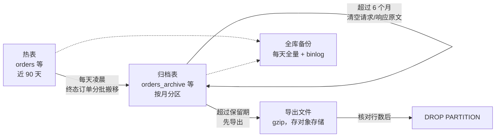

# 数据归档、备份与清理 · 实现计划

> 状态：**计划，未实现**（2026-10-21 写）。按每天几十万单设计，上线后按实际数据量校准第 1 章的估算和第 8 章的默认值。**开发前先确认第 12 章的待定事项。**

## 1. 背景

### 1.1 数据量估算

按每天 30 万单粗算（行大小含索引，上线一周后用 1.3 的 SQL 实测校准）：

| 表 | 每单约几行 | 每行约 | 每天 | 每月 | 每年 |
|---|---|---|---|---|---|
| `orders` | 1 | 1 KB | 0.3 GB | 9 GB | 110 GB |
| `order_attempts`（含 `request` / `response` 原文） | 1.2 | 2 KB | 0.7 GB | 21 GB | 260 GB |
| `order_notify_logs`（含 `payload` / `response`） | 1.1 | 0.6 KB | 0.2 GB | 6 GB | 70 GB |
| `merchant_balance_logs`（扣款 + 失败退款） | 1.3 | 0.3 KB | 0.1 GB | 3 GB | 40 GB |
| 合计 | | | **约 1.3 GB** | **约 40 GB** | **约 0.5 TB** |

行数：订单每年约 1.1 亿行，提交记录、通知记录、资金流水各 1 亿多行。

### 1.2 不处理会怎样

- **写入变慢**：`orders` 有 7 个二级索引，表越大，索引页越难全部留在内存里，下单、改状态的随机 IO 越多。
- **查询变慢**：列表的 `summary` 汇总、商户后台、导出都在大表上扫；后台首页「全部订单」（`DashboardAdminService` 调 `OrderDao::aggregate()` 不带时间）是**全表聚合**，上亿行时会扫几分钟。
- **备份恢复变慢**：全库几百 GB 后，`mysqldump` 导出和导入都要以小时计，出事时恢复时间不可接受。
- **磁盘**：一年半 TB，且只增不减。

### 1.3 实测数据量的 SQL

```sql
SELECT table_name, table_rows,
       ROUND(data_length / 1024 / 1024 / 1024, 2)  AS data_gb,
       ROUND(index_length / 1024 / 1024 / 1024, 2) AS index_gb
FROM information_schema.TABLES
WHERE table_schema = 'phone_bill'
ORDER BY data_length + index_length DESC;
```

`table_rows` 是估算值；要准确行数用 `SELECT COUNT(*) ... WHERE created_at >= ...` 按天抽查。

## 2. 目标

1. **热表只保留近期数据**（默认 90 天），大小稳定，不随时间增长。
2. **历史数据可查**：后台、商户后台、开放接口查单、导出都还能查到归档的订单和流水，只是要带时间范围或精确单号。
3. **过期数据按规则清除，清除前先导出成文件**，有记录可追溯。
4. **全库可恢复**：有定期全量备份 + binlog，能恢复到任意时间点，并定期演练。
5. 归档、清理在凌晨低峰执行，分小批次，不锁表、不影响下单。

## 3. 数据分级

| 表 | 增长 | 策略 |
|---|---|---|
| `orders`、`order_attempts`、`order_notify_logs` | 每天几十万行 | 订单终态且超过热数据天数后，三张表**一起**移到归档表；归档表按月分区，超过保留期导出后删分区 |
| `merchant_balance_logs` | 每天几十万行 | 超过热数据天数移到归档表；资金账，默认**不自动删除**（见第 11 章） |
| `order_attempts.request/response`、`order_notify_logs.payload/response` | 占订单相关数据一半以上 | 归档超过 N 个月后清空原文，只保留状态、HTTP 状态码、说明 |
| `admin_operation_logs` | 慢 | 超过 2 年直接删除（导出后） |
| `product_daily_stats`、`province_daily_stats`、新增的 `order_daily_stats` | 每天几百行 | 永久保留，长时间范围的报表都走这些汇总表 |
| `merchant_exports` | — | 已有 `MerchantExportCleanupCrontab` 清理，不变 |
| 商户、商品、供应商、加款申请、在线支付等 | 很慢 | 不处理 |

## 4. 总体方案



- **为什么不直接给 `orders` 分区**：MySQL 分区表的每个唯一索引都必须包含分区列，`orders` 的 `order_no` 唯一、`(merchant_id, merchant_order_no)` 唯一都要靠数据库保证（重复下单不重复扣款），加上 `created_at` 就保证不了。所以热表保持普通表、按主键分批删除；**归档表**不需要数据库级唯一约束，按月分区，删历史数据只要 `DROP PARTITION`，瞬间完成、不产生碎片。
- **归档表放在同一个库**（`orders_archive` 等），这样搬移可以在一个事务里完成，查询回退也只是换一张表。以后数据量再大，可以把归档表挪到单独的实例，代码只改连接名。

## 5. 归档表设计

新增四张表：`orders_archive`、`order_attempts_archive`、`order_notify_logs_archive`、`merchant_balance_logs_archive`。

- **字段与热表完全相同**（同名同类型），多一列 `archived_at`；提交记录、通知记录的归档表再多一列 `order_created_at`（所属订单的下单时间）。
- **分区列**：订单、资金流水用自己的 `created_at`；提交记录、通知记录用 `order_created_at`，保证一个订单的数据落在同一个月分区、一起被删。
- **主键** `(id, 分区列)`（分区列必须在主键里），`id` 沿用热表的值，不自增。
- **分区**：`PARTITION BY RANGE COLUMNS(分区列)`，每月一个分区，命名 `p202610`，最后一个 `pmax`。定时任务提前建好未来 2 个月的分区（从 `pmax` 拆出）。迁移里用 `Db::statement()` 写原生 DDL。
- **索引**（都是普通索引）：

| 表 | 索引 |
|---|---|
| `orders_archive` | `order_no`；`(merchant_id, merchant_order_no)`；`(mobile, created_at)`；`(merchant_id, created_at)`；`(supplier_id, created_at)`；`created_at` |
| `order_attempts_archive` | `order_id`；`attempt_no`；`(supplier_id, supplier_order_no)` |
| `order_notify_logs_archive` | `order_id` |
| `merchant_balance_logs_archive` | `(merchant_id, id)`；`order_id`；`(merchant_id, created_at)` |

- **字段同步**：以后给 `orders` 等加字段的迁移，必须同时给归档表加同样的字段。加一个单元测试：比较热表和归档表的字段列表（`Schema::getColumnListing()`），不一致就失败。搬移的 SQL 用这个字段列表显式列出列名，不用 `SELECT *`。

## 6. 归档规则

### 6.1 哪些订单可以归档

同时满足才搬：

1. `created_at` 早于「今天 0 点 − 热数据天数」；
2. `status` 是 `success` 或 `failed`（`pending` / `processing` / `abnormal` 一律不搬，异常订单处理完才搬）；
3. `notify_status` 不是 `pending` / `retrying`（还在通知商户的不搬）；
4. 没有 `processing` 状态的提交记录。

不满足条件的老订单留在热表，每次归档结束在日志和归档记录里报出数量，超过 0 的要人工看一下（通常是忘了处理的异常订单）。

资金流水只看 `created_at`，超过热数据天数就搬（流水只增不改）。

### 6.2 搬移过程（`DataArchiveService`）

1. 用 `created_at` 索引找出截止时间之前的最大 `id`，作为本次的上界；从上次进度（或 0）开始按 `id` 升序，每批取 1000 个订单。
2. 每批一个事务：
    1. `SELECT ... FROM orders WHERE id IN (...) FOR UPDATE`，**在锁内重新判断 6.1 的条件**（防止同时有人手动回调、晚到的上游结果改了订单），不满足的剔除；
    2. `INSERT IGNORE INTO order_attempts_archive (...) SELECT ...（连同订单的 created_at 作为 order_created_at） FROM order_attempts JOIN orders ... WHERE order_id IN (...)`，通知记录同理，最后插订单；
    3. 核对插入行数和查出的行数一致，不一致回滚并报错；
    4. 依次 `DELETE` 通知记录、提交记录、订单（都按主键 / `order_id` 索引）。
3. 每批之后 `usleep` 50 ms，给线上让出 IO；单次运行有时长上限（默认到 06:30 停），没搬完的下次继续。
4. `INSERT IGNORE` + 先插后删 + 一个事务，保证中途崩溃重跑不会丢数据也不会重复。
5. 资金流水同样按 `id` 分批，每批 5000 行。

### 6.3 执行时间

- `DataArchiveCrontab`：每天 04:00（在 03:00 商品统计、03:30 导出清理之后），`singleton`、`onOneServer`，`mutexExpires` 3 小时。
- 每天新增约 30 万单，每批 1000 单约 300 批，预计 5～10 分钟。上线一段时间后**第一次**开启时积压较多，靠时长上限分几天搬完。
- 热表删除后的空间 InnoDB 会复用，表文件不会缩小但也不再长大，不需要定期 `OPTIMIZE`。第一次搬完积压后可以在低峰执行一次 `ALTER TABLE orders FORCE`（在线重建）收回空间，可选。

### 6.4 归档记录表 `data_archive_runs`

每次运行一行：`task`（`archive_orders` / `archive_balance_logs` / `trim_payload` / `purge_partition` / `add_partition`）、`cutoff`（截止时间或分区名）、`last_id`（进度）、`rows`（JSON，每张表处理了多少行）、`skipped`（不满足条件留在热表的订单数）、`file`（导出文件路径和校验值）、`status`（`running` / `success` / `partial` / `failed`）、`message`、`started_at`、`finished_at`。

## 7. 对现有功能的影响和改造

| 功能 | 现状 | 改造 |
|---|---|---|
| **下单防重**（商户订单号在商户内唯一） | 靠热表唯一索引 | 下单逻辑不改，只查热表：商户订单号的唯一性**只保证热数据天数内**，超过后同一个号再来按新单处理（2026-10-21 定）。开启归档前在 [api.md](api.md) 的 `merchant_order_no` 说明里写明「订单号在你的商户内唯一，平台只在 90 天内校验重复，请不要重复使用订单号」 |
| **开放接口查单** `GET /open/v1/order` | 只查热表 | 热表查不到**必须**再查归档表：接入文档说查单返回 `ORDER_NOT_FOUND` 可以用同一个订单号重新提交，归档订单如果返回 `ORDER_NOT_FOUND`，商户照做就会重复扣款 |
| **供应商回调 / 主动查单** | `OrderAttemptDao::findForSupplier()` | 不改。热数据保留期远大于查单和通知的时间，归档订单再来回调只记 warning 日志、返回成功 |
| **后台订单中心** | 只查热表 | 列表加「历史订单」切换：查归档表时必须带时间范围（不超过 31 天，能命中少数几个分区），或精确的平台/商户订单号、手机号。详情页能看归档订单（标「已归档」），**不能**做手动查单、处理、冲正、补单、手动回调 |
| **冲正、人工处理归档订单** | — | 正常不应发生；确实需要时用命令 `data:restore-order {order_no}` 把这个订单连同提交记录、通知记录搬回热表，再在后台操作（记操作日志） |
| **商户后台**订单记录、资金流水 | 只查热表；按订单号、手机号不限日期 | 同后台：加「历史记录」切换，规则同上；按单号查流水时热表没有再查归档表 |
| **导出**（后台、商户） | 只查热表 | 时间范围早于热数据天数的部分查归档表，拼在一起输出 |
| **后台首页「全部订单」** | `OrderDao::aggregate()` 全表聚合 | 新增 `order_daily_stats`（日期 + 商户：订单数、成功数、成功金额、利润），每天凌晨汇总前一天；首页 = 汇总表合计 + 今天实时。**这一项不依赖归档，数据量上来之前就该改** |
| **商品 / 省份统计重算** `stats:product-daily` 等 | 从热表算 | 指定日期早于热数据天数时提示无法重算（或改成从归档表算） |
| **上线前清测试数据** `DataCleanupService` | 列了热表 | `TABLES` 加上四张归档表和 `data_archive_runs` |

Dao 层的做法：给 `OrderDao`、`OrderAttemptDao`、`OrderNotifyLogDao`、`MerchantBalanceLogDao` 加 `archived` 参数或对应的 `*ArchiveDao`，Service 层决定先查哪张表；归档 Model 继承热表 Model，只改 `$table`，详情页、导出复用同一套格式化代码。

## 8. 清理规则

| 对象 | 默认 | 做法 |
|---|---|---|
| 归档提交记录、通知记录的原文 | 归档 6 个月后清空 | 按分区分批 `UPDATE ... SET request = NULL, response = NULL`（通知记录清 `payload` / `response`），然后 `ALTER TABLE ... OPTIMIZE PARTITION` 收回空间；只动归档表，不碰热表 |
| 归档订单（含提交、通知记录） | 保留 24 个月 | 到期的月分区：先导出（9 章）→ 核对文件行数 = 分区行数 → 记录到 `data_archive_runs` → `DROP PARTITION`。导出失败绝不删 |
| 归档资金流水 | 不删除 | 资金账，保留期待定（第 11 章）；设了保留期也按上面先导出再删分区 |
| 操作日志 `admin_operation_logs` | 保留 24 个月 | 导出后按 `id` 分批删除 |

清理任务 `DataPurgeCrontab` 每月 2 号 04:30 执行，同时检查并建好未来 2 个月的分区。默认**关闭**，在后台设置里确认保留期后再开。

## 9. 备份

### 9.1 全库备份（运维，不在应用里实现）

- **每天全量**：用 Percona XtraBackup 物理备份（几百 GB 时 `mysqldump` 太慢，恢复更慢）；用云数据库的话直接开自动备份。
- **binlog**：开 `ROW` 格式，保留 7 天以上，配合全量可以恢复到任意时间点（误删、误改时用）。
- **保留**：最近 7 份每日 + 4 份每周 + 12 份每月；**必须拷到另一台机器或对象存储**，不能只放在数据库服务器上。
- **演练**：每季度在另一台机器上做一次完整恢复，记录耗时，确认备份可用。
- 执行有风险的操作（`data:clean-orders-products`、大的迁移、第一次开启清理）之前，先手动做一次备份。
- 脚本和步骤写进 `deploy/` 和 README 的部署章节。

### 9.2 归档分区导出（应用实现）

- 删分区前，用 `mysqldump --single-transaction --where="created_at >= '…' AND created_at < '…'"` 导出这个月四张归档表的数据（子表按 `order_created_at`）（或 `SELECT ... INTO OUTFILE`），gzip 压缩，算 SHA-256。
- 文件存到 `storage/archive/2026/10/` 并上传到对象存储（和加款凭证用同一个存储配置），本地保留 30 天。
- 需要查已删除的历史数据时，把文件导入一个临时库查询，不回灌线上库。

## 10. 配置、命令和后台页面

### 10.1 配置（存 `system_settings`，后台可改）

| 参数 | 默认值 |
|---|---|
| 启用自动归档 | 关（上线确认后开） |
| 订单、资金流水热数据天数 | 90 天（不得小于 30 天） |
| 归档原文保留 | 6 个月 |
| 归档订单保留 | 24 个月 |
| 归档资金流水保留 | 永久 |
| 操作日志保留 | 24 个月 |
| 启用自动清理（删分区） | 关 |
| 每批行数 / 批间隔 / 每天最晚运行到 | 1000 行 / 50 ms / 06:30 |

### 10.2 命令

```bash
php bin/hyperf.php data:archive --dry-run              # 只统计每张表会搬多少行、多少订单不满足条件
php bin/hyperf.php data:archive [--until=2026-07-01] [--max-minutes=60]
php bin/hyperf.php data:archive-partitions             # 检查并建好未来 2 个月的分区
php bin/hyperf.php data:purge --dry-run                # 列出到期的分区和行数
php bin/hyperf.php data:purge                          # 导出并删除到期分区，要输入数据库名确认
php bin/hyperf.php data:restore-order {order_no}       # 把一个归档订单搬回热表
```

### 10.3 后台

- **系统设置 → 数据归档**：上面的参数；热表 / 归档表的行数和大小（`information_schema`）；最近的归档记录（`data_archive_runs`）。
- 订单中心、资金流水的「历史订单 / 历史记录」切换见第 7 章。
- 权限：新增 `data.archive`（查看和修改归档设置）；查历史订单沿用 `order.view`。
- 日志：单独的 `archive` 日志渠道；归档或清理失败、不满足条件留在热表的订单超过阈值时，走第五阶段的告警渠道。

## 11. 实施步骤

| 步骤 | 内容 | 完成标准 |
|---|---|---|
| 一 · 先做 | `order_daily_stats` + 后台首页改用汇总表；按 1.3 实测各表大小 | 首页不再全表聚合；有一周的实测数据 |
| 二 · 归档 | 四张归档表 + 分区维护；`DataArchiveService`、`data:archive`、`DataArchiveCrontab`、`data_archive_runs`；字段同步测试；开放接口查单回退查归档表；api.md 写明订单号只在 90 天内校验重复；`DataCleanupService` 加表 | 测试库造 100 天数据跑通：只搬符合条件的；中途 kill 重跑不丢不重；搬移期间下单、回调不受影响；按商户订单号查已归档的订单能查到 |
| 三 · 查询 | 后台、商户后台历史订单 / 历史记录；详情页；导出跨热表和归档表；`data:restore-order` | 归档订单在两个后台都能查到、导出；不能对归档订单做人工操作 |
| 四 · 清理 | 原文清空、分区导出 + 删除、操作日志清理、设置页 | 导出文件能导回临时库，行数一致；导出失败时不删分区 |
| 五 · 备份 | XtraBackup / 云备份 + binlog + 异地存放 + 恢复演练手册 | 完成一次完整恢复演练 |

步骤一、五和其他步骤无依赖，可以先做。

## 12. 待定事项（开发前必须先定）

以下几项目前定不了，**开始开发本功能前逐项确认**，定下来后把结果写回本章和对应章节。

| 事项 | 影响 | 状态 |
|---|---|---|
| 热数据保留多少天（建议 90 天；看商户投诉、对账、冲正通常在多久以内） | 热表大小、多少查询要走归档 | 待定 |
| 归档订单保留多久（建议 24 个月） | 磁盘、合规 | 待定 |
| 资金流水是否永久保留 | 磁盘、合规 | 待定 |
| 商户订单号永久唯一，还是只在热数据天数内唯一 | 下单防重、接入文档 | 待定；暂按「只在热数据天数内唯一」写（2026-10-21），见第 7 章 |
| 数据库自建 MySQL 还是用云数据库 | 备份方案（第 9.1 节） | 待定 |
| 导出文件和备份放哪个对象存储 | 第 9 章 | 待定 |
