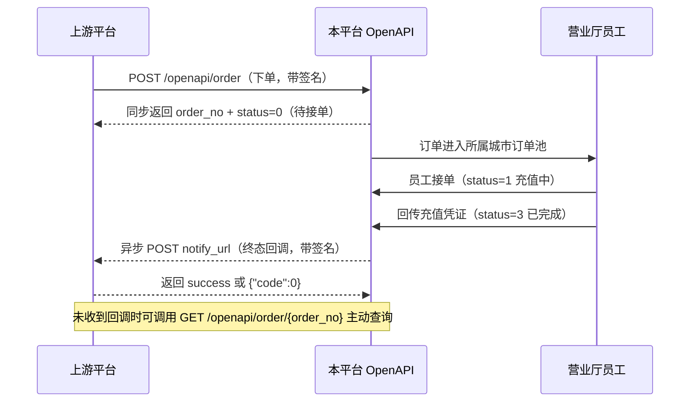

# 话费充值 · 上游对接接口文档

> 版本：v1.0　　适用范围：上游平台 → 本平台（下游承接方）
>
> 本文档面向对接方技术人员，包含鉴权签名、下单/查单接口、异步回调通知、状态与错误码全量说明。

---

## 1. 业务概述

上游平台通过 OpenAPI 将话费充值订单推送至本平台，本平台将订单分发到线下营业厅由员工完成充值，订单到达终态后异步回调通知上游。

对接方需要实现三件事：

1. **调用下单接口**推送订单；
2. **实现回调接收接口**，接收本平台推送的订单终态；
3. （可选，作为回调的兜底）**调用查单接口**主动轮询订单状态。

### 交互时序



### 关键规则速览

| 规则 | 说明 |
| --- | --- |
| 幂等 | 同一商户下 `upstream_order_no` 唯一，重复下单直接返回首次创建的订单，不会重复扣款 |
| 同号在途 | 同一手机号存在处理中订单时拒绝下单（错误码 `40108`） |
| 余额预扣 | 下单成功即按 `price` 划扣本平台预存余额，订单退单/冲正时自动退回 |
| 终态回调 | 仅 `3/5/6/7` 四个终态触发回调，最多重试 5 次 |
| 地区限制 | 仅开放地区可下单，且受订单池容量、当日总量限制 |

---

## 2. 接入准备

### 2.1 本平台需向上游提供

| 项目 | 说明 |
| --- | --- |
| `接口地址` | 生产 / 测试环境的 Base URL |
| `merchant_no` | 商户号，仅用于标识对账，不参与请求 |
| `api_key` | 请求身份标识，放在请求头 `X-Api-Key` |
| `secret` | 签名密钥，**仅在创建商户和重置密钥时展示一次**，请妥善保存，切勿泄露或提交到代码仓库 |

### 2.2 上游需向本平台提供

| 项目 | 说明 |
| --- | --- |
| 出口 IP 列表 | 用于配置 IP 白名单。**白名单为空表示不限制**，生产环境建议务必配置 |
| `notify_url` | 默认回调地址，配置在商户信息中；下单时也可逐单指定覆盖 |

### 2.3 环境地址

| 环境 | Base URL |
| --- | --- |
| 测试 | `https://test-api.your-domain.com` |
| 生产 | `https://api.your-domain.com` |

> 上述地址为占位示例，以实际交付为准。

---

## 3. 通用约定

### 3.1 请求

| 项目 | 约定 |
| --- | --- |
| 传输协议 | HTTPS |
| 字符编码 | UTF-8 |
| POST 提交格式 | **推荐 `application/x-www-form-urlencoded`**，也支持 `application/json`（注意事项见 4.4） |
| 时间格式 | 秒级 Unix 时间戳（10 位整数） |
| 金额格式 | 数字字符串，最多两位小数，单位：元 |

### 3.2 公共请求头

所有 `/openapi/*` 接口均必须携带以下请求头：

| 请求头 | 必填 | 说明 |
| --- | --- | --- |
| `X-Api-Key` | 是 | 商户 API Key |
| `X-Timestamp` | 是 | 当前秒级时间戳，与服务器时间偏差需在 **±300 秒** 内 |
| `X-Sign` | 是 | 签名值，算法见第 4 章，大写 32 位 MD5 |
| `Content-Type` | POST 必填 | `application/x-www-form-urlencoded` 或 `application/json` |

> 请确保调用方服务器已开启 NTP 时间同步，时间漂移会直接导致 `50103` 错误。

### 3.3 响应

**所有接口（包括业务失败）的 HTTP 状态码恒为 `200`**，业务结果只看响应体中的 `code` 字段。请勿以 HTTP 状态码判断成败。

响应体结构统一为：

```json
{
  "code": 0,
  "message": "下单成功",
  "data": {}
}
```

| 字段 | 类型 | 说明 |
| --- | --- | --- |
| `code` | int | `0` 表示成功，非 `0` 表示失败，取值见第 7 章 |
| `message` | string | 结果描述，可直接用于日志排查，**请勿用于程序逻辑判断** |
| `data` | object/null | 业务数据，失败时为 `null` |

参数校验失败时 `data` 中额外携带字段级错误明细：

```json
{
  "code": 10001,
  "message": "充值手机号格式不正确",
  "data": { "errors": { "phone": ["充值手机号格式不正确"] } }
}
```

### 3.4 限流

按商户维度限流，**默认每秒 20 次请求**（具体额度以实际配置为准）。超限返回 `60001`，建议上游做好队列削峰与退避重试。

---

## 4. 签名算法

### 4.1 算法步骤

1. 收集**全部业务参数**（URL Query 参数 + Body 参数），并追加 `timestamp`（值与请求头 `X-Timestamp` 完全一致）；
2. **剔除** `sign` 字段，以及值为 `null`、空字符串 `""`、数组/对象类型的字段；
3. 按参数名（key）的 **ASCII 升序**排序；
4. 拼接成 `k1=v1&k2=v2&...` 格式（**不做 URL 编码**）；
5. 末尾追加 `&key={secret}`；
6. 对结果做 **MD5** 并**转为大写**，得到 `X-Sign`。

用公式表示：

```
sign = UPPER( MD5( "k1=v1&k2=v2&...&kn=vn" + "&key=" + secret ) )
```

### 4.2 示例一：下单接口签名

假设 `secret = abcdef1234567890`，请求参数如下：

| 参数 | 值 |
| --- | --- |
| `upstream_order_no` | `UP20260727000001` |
| `phone` | `13800138000` |
| `face_value` | `50` |
| `price` | `48.50` |
| `timestamp` | `1769493600` |

排序拼接后的**待签名字符串**：

```text
face_value=50&phone=13800138000&price=48.50&timestamp=1769493600&upstream_order_no=UP20260727000001&key=abcdef1234567890
```

计算结果：

```text
X-Sign: 179982F6FD7B6CC0B3CEE22C8D610CCF
```

### 4.3 示例二：查单接口签名

查单为 `GET /openapi/order/{order_no}`，**订单号是 URL 路径的一部分，不属于 Query 参数，因此不参与签名**。若无任何 Query 参数，则只有 `timestamp` 参与签名：

```text
timestamp=1769493600&key=abcdef1234567890
```

```text
X-Sign: 132025CDB10B2452638F3FF969BF5394
```

### 4.4 重要注意事项

> 以下几点是对接过程中最容易出问题的地方，请务必阅读。

1. **强烈建议使用 `application/x-www-form-urlencoded` 提交**。
   服务端参与签名的是解析后的参数值。表单提交时所有值都是字符串，"签什么就传什么"，不会出现歧义。

2. **若使用 JSON 提交，所有字段值必须写成字符串。**
   JSON 数字会被服务端按数值类型解析，再转字符串时可能与你签名时的写法不一致，例如 `48.50` 会变成 `48.5`、`50.00` 会变成 `50`，导致签名校验失败。正确写法：

   ```json
   { "face_value": "50", "price": "48.50" }
   ```

   错误写法：

   ```json
   { "face_value": 50.00, "price": 48.50 }
   ```

3. **空值字段不参与签名**。不传的可选参数（如 `notify_url`、`province`、`city`）请直接省略，不要传空字符串。

4. **拼接时不要做 URL 编码**，直接使用参数原始值。

5. `timestamp` 必须同时出现在请求头 `X-Timestamp` 和签名串中，且两者取值完全一致。

6. 签名结果为**大写**十六进制字符串（服务端比对时会统一转大写，小写亦可通过，但建议按规范传大写）。

### 4.5 签名代码示例

**PHP**

```php
function makeSign(array $params, string $secret): string
{
    unset($params['sign']);
    ksort($params);

    $pairs = [];
    foreach ($params as $key => $value) {
        if ($value === null || $value === '' || is_array($value)) {
            continue;
        }
        $pairs[] = $key . '=' . $value;
    }

    return strtoupper(md5(implode('&', $pairs) . '&key=' . $secret));
}
```

**Java**

```java
public static String makeSign(Map<String, String> params, String secret) throws Exception {
    StringBuilder sb = new StringBuilder();
    new TreeMap<>(params).forEach((k, v) -> {
        if (!"sign".equals(k) && v != null && !v.isEmpty()) {
            if (sb.length() > 0) {
                sb.append('&');
            }
            sb.append(k).append('=').append(v);
        }
    });
    sb.append("&key=").append(secret);

    MessageDigest md = MessageDigest.getInstance("MD5");
    byte[] digest = md.digest(sb.toString().getBytes(StandardCharsets.UTF_8));

    StringBuilder hex = new StringBuilder();
    for (byte b : digest) {
        hex.append(String.format("%02X", b));
    }
    return hex.toString();
}
```

**Python**

```python
import hashlib


def make_sign(params: dict, secret: str) -> str:
    pairs = [
        f"{k}={v}"
        for k, v in sorted(params.items())
        if k != "sign" and v is not None and v != "" and not isinstance(v, (list, dict))
    ]
    raw = "&".join(pairs) + "&key=" + secret
    return hashlib.md5(raw.encode("utf-8")).hexdigest().upper()
```

**Go**

```go
func MakeSign(params map[string]string, secret string) string {
    keys := make([]string, 0, len(params))
    for k, v := range params {
        if k != "sign" && v != "" {
            keys = append(keys, k)
        }
    }
    sort.Strings(keys)

    pairs := make([]string, 0, len(keys))
    for _, k := range keys {
        pairs = append(pairs, k+"="+params[k])
    }

    raw := strings.Join(pairs, "&") + "&key=" + secret
    return strings.ToUpper(fmt.Sprintf("%x", md5.Sum([]byte(raw))))
}
```

---

## 5. 接口详情

### 5.1 下单

推送一笔话费充值订单。

| 项目 | 说明 |
| --- | --- |
| 请求方式 | `POST` |
| 请求路径 | `/openapi/order` |
| Content-Type | `application/x-www-form-urlencoded`（推荐） |

#### 请求参数

| 参数 | 类型 | 必填 | 约束 | 说明 |
| --- | --- | --- | --- | --- |
| `upstream_order_no` | string | 是 | 最长 64 字符 | 上游订单号，**同一商户下必须唯一**，用作幂等键 |
| `phone` | string | 是 | `^1\d{10}$` | 充值手机号 |
| `face_value` | number | 是 | > 0，最多两位小数 | 充值面值（元），须为本平台已上架的面值 |
| `price` | number | 是 | > 0，最多两位小数 | 结算价（元），下单时按此金额划扣平台预存余额 |
| `notify_url` | string | 否 | 合法 URL，最长 255 字符 | 本单回调地址，不传则使用商户默认回调地址 |
| `province` | string | 否 | 最长 30 字符 | 省份，不传则按号段库自动识别 |
| `city` | string | 否 | 最长 50 字符 | 城市，不传则按号段库自动识别 |

> **说明：**运营商始终以本平台号段库识别结果为准，上游无需传递；`province` / `city` 传入后会覆盖号段库的识别结果，用于订单归属城市的订单池调度，若无特殊需求建议不传。

#### 请求示例

```http
POST /openapi/order HTTP/1.1
Host: api.your-domain.com
X-Api-Key: YOUR_API_KEY
X-Timestamp: 1769493600
X-Sign: 179982F6FD7B6CC0B3CEE22C8D610CCF
Content-Type: application/x-www-form-urlencoded

upstream_order_no=UP20260727000001&phone=13800138000&face_value=50&price=48.50
```

#### 响应参数（`data`）

| 字段 | 类型 | 说明 |
| --- | --- | --- |
| `order_no` | string | **本平台订单号**，后续查单、对账以此为准，请务必落库保存 |
| `upstream_order_no` | string | 上游订单号，原样返回 |
| `phone` | string | 充值手机号 |
| `operator` | int | 运营商：`1`=移动 `2`=联通 `3`=电信 |
| `face_value` | float | 面值（元） |
| `price` | float | 结算价（元） |
| `province` | string | 省份 |
| `city` | string | 城市 |
| `status` | int | 订单状态，取值见 6.1 |
| `status_name` | string | 状态中文名 |
| `create_time` | int | 下单时间（秒级时间戳） |
| `finish_time` | int | 终态时间（秒级时间戳），未到终态为 `0` |

#### 响应示例

```json
{
  "code": 0,
  "message": "下单成功",
  "data": {
    "order_no": "R260727120000482913",
    "upstream_order_no": "UP20260727000001",
    "phone": "13800138000",
    "operator": 1,
    "face_value": 50,
    "price": 48.5,
    "province": "四川省",
    "city": "成都市",
    "status": 0,
    "status_name": "待接单",
    "create_time": 1769493600,
    "finish_time": 0
  }
}
```

#### 幂等说明

同一商户使用相同 `upstream_order_no` 重复请求时，接口返回 `code=0` 及**首次创建的订单信息**（此时 `status` 为该订单的实时状态），不会重复建单、不会重复扣款。因此上游在遇到网络超时等不确定结果时，可安全地用相同单号重试。

---

### 5.2 查单

按本平台订单号查询订单状态，仅可查询本商户自己的订单。

| 项目 | 说明 |
| --- | --- |
| 请求方式 | `GET` |
| 请求路径 | `/openapi/order/{order_no}` |

#### 路径参数

| 参数 | 类型 | 必填 | 说明 |
| --- | --- | --- | --- |
| `order_no` | string | 是 | 本平台订单号（下单接口返回的 `order_no`） |

> 路径参数不参与签名，签名串仅包含 `timestamp`（详见 4.3）。

#### 请求示例

```http
GET /openapi/order/R260727120000482913 HTTP/1.1
Host: api.your-domain.com
X-Api-Key: YOUR_API_KEY
X-Timestamp: 1769493600
X-Sign: 132025CDB10B2452638F3FF969BF5394
```

#### 响应

`data` 结构与下单接口完全一致。订单不存在或不属于当前商户，返回 `40100`。

```json
{
  "code": 0,
  "message": "成功",
  "data": {
    "order_no": "R260727120000482913",
    "upstream_order_no": "UP20260727000001",
    "phone": "13800138000",
    "operator": 1,
    "face_value": 50,
    "price": 48.5,
    "province": "四川省",
    "city": "成都市",
    "status": 3,
    "status_name": "已完成",
    "create_time": 1769493600,
    "finish_time": 1769493900
  }
}
```

#### 轮询建议

回调为主、查单为辅。建议对未收到回调且创建时间超过 10 分钟的订单，按 1～5 分钟的间隔轮询，避免高频空转触发限流。

---

## 6. 异步回调通知

订单到达**终态**时，本平台会向 `notify_url` 发起回调。

| 项目 | 说明 |
| --- | --- |
| 请求方式 | `POST` |
| Content-Type | `application/json` |
| 超时时间 | 10 秒 |
| 触发时机 | 订单进入终态（`3` 已完成 / `5` 已拒绝 / `6` 已退单 / `7` 已冲正） |
| 重试策略 | 最多 **5 次**，失败后按 **60s / 300s / 900s / 3600s** 的间隔递增重试 |

### 6.1 订单状态枚举

| 值 | 名称 | 是否终态 | 说明 |
| --- | --- | --- | --- |
| `0` | 待接单 | 否 | 已入订单池，等待营业厅员工接单 |
| `1` | 充值中 | 否 | 员工已接单，正在充值 |
| `2` | 待审核 | 否 | 历史状态，当前流程不再产生 |
| `3` | **已完成** | 是 | 员工回传充值凭证，充值成功 |
| `4` | 已驳回 | 否 | 历史状态，当前流程不再产生 |
| `5` | **已拒绝** | 是 | 下单被拒，未进入订单池 |
| `6` | **已退单** | 是 | 压单超时自动取消或平台手动退单，`price` 已退回预存余额 |
| `7` | **已冲正** | 是 | 订单完成后经核查回滚（如充值实际未到账），`price` 已退回预存余额 |

> 上游需重点处理 `7 已冲正`：该状态表示一笔**先前已通知为成功**的订单被撤销，上游应据此为终端用户退款或重新发起充值。

### 6.2 回调请求体

| 字段 | 类型 | 说明 |
| --- | --- | --- |
| `order_no` | string | 本平台订单号 |
| `upstream_order_no` | string | 上游订单号 |
| `phone` | string | 充值手机号 |
| `face_value` | float | 面值（元） |
| `price` | float | 结算价（元） |
| `status` | int | 订单终态 |
| `status_name` | string | 状态中文名 |
| `finish_time` | int | 终态时间（秒级时间戳） |
| `timestamp` | int | 回调发起时间（秒级时间戳） |
| `sign` | string | 签名，算法同第 4 章（对除 `sign` 外的全部字段签名） |

```json
{
  "order_no": "R260727120000482913",
  "upstream_order_no": "UP20260727000001",
  "phone": "13800138000",
  "face_value": 50,
  "price": 48.5,
  "status": 3,
  "status_name": "已完成",
  "finish_time": 1769493900,
  "timestamp": 1769493900,
  "sign": "9895651CCA5C06027E622DB970EFA2CD"
}
```

上例对应的待签名字符串为（`secret = abcdef1234567890`）：

```text
face_value=50&finish_time=1769493900&order_no=R260727120000482913&phone=13800138000&price=48.5&status=3&status_name=已完成&timestamp=1769493900&upstream_order_no=UP20260727000001&key=abcdef1234567890
```

> **注意：**回调体中的 `face_value`、`price` 为 JSON 数字类型，验签时请按其**原始字符串形态**参与拼接（如 `48.5` 而非 `48.50`、`50` 而非 `50.00`）。建议直接对原始 JSON 报文做解析后取值，避免经过金额格式化处理。`status_name` 为中文，请以 UTF-8 编码计算 MD5。

### 6.3 上游应答要求

上游收到回调后需返回以下任一响应，否则视为失败并进入重试：

- 响应体为纯文本 `success`
- 或响应体为 JSON `{"code": 0}`

### 6.4 回调接收方注意事项

1. **必须验签**，防止伪造回调；
2. **必须做幂等处理**，同一订单可能因重试收到多次回调，请按 `order_no` 去重；
3. **先落库再返回成功**，收到后应尽快应答（10 秒内），耗时业务放入异步队列处理；
4. 回调地址需可被本平台服务器公网访问，且建议使用 HTTPS。

---

## 7. 错误码

### 7.1 通用

| code | 含义 | 处理建议 |
| --- | --- | --- |
| `0` | 成功 | — |
| `10000` | 操作失败 | 查看 `message` 排查 |
| `10001` | 参数错误 | 按 `data.errors` 修正参数，**不可重试** |
| `10002` | 数据不存在 | 不可重试 |
| `500` | 服务器内部错误 | 可稍后重试，并联系平台方 |

### 7.2 鉴权与签名

| code | 含义 | 处理建议 |
| --- | --- | --- |
| `50100` | 签名校验失败 | 核对签名算法、`secret`、参数拼接顺序，**不可重试** |
| `50101` | IP 不在白名单内 | 联系平台方补充出口 IP |
| `50102` | 商户不存在或已禁用 | 核对 `X-Api-Key`，或联系平台方 |
| `50103` | 请求时间戳无效 | 校准服务器时间（要求 ±300 秒内） |
| `60001` | 请求频率超限 | 退避后重试 |

### 7.3 下单业务

| code | 含义 | 可否重试 | 说明 |
| --- | --- | --- | --- |
| `40100` | 订单不存在 | 否 | 查单时订单号错误或不属于本商户 |
| `40103` | 手机号归属地识别失败 | 否 | 号段库中无该号段，请核对号码 |
| `40104` | 商品不可用或该地区未定价 | 否 | 该运营商/面值组合未上架，或目标城市未配置价格 |
| `40105` | 该地区未开放放单 | 否 | 订单归属城市未开通，请改派其他渠道 |
| `40106` | 该地区订单池已满 | **是** | 池内待接单量达上限，稍后重试 |
| `40107` | 该地区当日订单总量已达上限 | 次日 | 当天该城市不再接单 |
| `40108` | 该手机号存在处理中的订单 | **是** | 等待前一单结束后重试 |
| `40109` | 平台余额不足 | **是** | 平台预存款不足，联系平台方充值后重试 |

> 标注"可重试"的错误建议采用指数退避策略，并设置最大重试次数与超时兜底，避免订单长时间悬挂。

---

## 8. 联调 Checklist

对接方在提测前请逐项自检：

- [ ] 已获取 `api_key` / `secret`，并已向平台方提供出口 IP 与回调地址
- [ ] 服务器已开启时间同步，`X-Timestamp` 与真实时间一致
- [ ] 签名严格按 4.1 步骤实现，空值字段已剔除，未做 URL 编码
- [ ] POST 使用表单提交；若用 JSON，所有值均为字符串
- [ ] 已按 `code` 而非 HTTP 状态码判断业务成败
- [ ] 已保存本平台返回的 `order_no` 并与上游单号建立映射
- [ ] 下单超时/网络异常时，使用**相同** `upstream_order_no` 重试
- [ ] 回调接口已实现验签、幂等去重，并返回 `success`
- [ ] 已处理 `7 已冲正` 场景下的用户退款/补单逻辑
- [ ] 已实现查单轮询作为回调缺失的兜底

## 9. 常见问题

**Q：一直返回 `50100` 签名校验失败？**
A：请打印你本地的**待签名原始字符串**与平台方日志比对。九成以上的问题出自：金额用了 JSON 数字类型导致小数位差异（`48.50` vs `48.5`）、空值字段参与了签名、漏拼 `&key=secret`、或 `timestamp` 与请求头不一致。

**Q：查单接口的签名要不要带订单号？**
A：不带。订单号在 URL 路径中而非 Query，签名串只有 `timestamp` 一项。

**Q：下单成功但用户没收到话费？**
A：下单成功仅代表订单已受理入池，实际充值结果以终态回调（`status=3`）为准，请勿在下单成功时即向用户发货。

**Q：订单一直是 `0 待接单` 怎么办？**
A：说明当地暂无员工接单。超过压单时限后系统会自动退单（`status=6`）并退回结算金额，同时触发回调。

**Q：`price` 和 `face_value` 有什么区别？**
A：`face_value` 是给用户充的面值（如 50 元话费），`price` 是上游与本平台结算的价格（如 48.50 元），本平台按 `price` 划扣上游预存余额。

---

**文档维护：**本文档随接口变更同步更新，接口调整将提前通知对接方。技术对接问题请联系平台方技术支持。

---

## 我们的对接方式（驱动 `yingyeting`）

> 以下是 phoneBill 这边接入这家上游的规则，不属于上游原文档。

- 接口参数：接口地址（Base URL，路径 `/openapi/order` 写在驱动里）、API Key、签名密钥。回调地址按系统配置的回调域名自动生成（`回调域名/notify/supplier/{供应商编码}`），每单随下单请求的 `notify_url` 传过去。
- 字段对应：`upstream_order_no` = 提交单号 `attempt_no`，`phone` = 手机号，`face_value` = 面值，**`price` = 这次提交的成本价（供应商商品上配的进价）**，上游按它扣我们的预存款。不传 `province` / `city`，按上游号段库识别。上游返回的 `order_no` 存为供应商订单号。
- 下单用表单提交（文档推荐），签名按第 4 章，三个示例都已核对。回调按收到的全部字段验签（JSON 数字按报文原样参与），通过后回 `success`。
- 查单只能按上游订单号查。下单时没拿到返回（没有上游订单号）的提交查不了，订单会因为接口异常已经转成人工处理单，到上游核实。**不能**用同一个 `upstream_order_no` 再调一次下单接口来「查」：第一次没到上游的话，这一调就是真的下了一单。
- 上游没有余额、商品列表接口：后台余额显示「不支持」，供应商商品手动建，成本价要和上游给我们的结算价一致。

| 情况 | 结果 |
|---|---|
| 下单 `code=0` | 按 `data.status` 判断，一般是 `0` 待接单：处理中，存下上游订单号 |
| 下单 `code` 不是 0（含 `10001`、`10002`、`50100`～`50103`、`60001`、`40103`～`40109`、`500`、`10000` 和表外错误码） | 失败，换下一个供应商（2026-10-15 定：上游有返回、不是成功码就判失败） |
| 下单网络超时、连不上、HTTP 出错、返回无法解析（没有拿到返回值） | 立即转异常订单并标为人工处理单：上游结果只记录，状态和回调全部人工（见 docs/project.md 2.5） |
| 查单 / 回调 `status` 3 已完成 | 成功 |
| 查单 / 回调 `status` 5 已拒绝、6 已退单 | 失败 |
| 查单 / 回调 `status` 7 已冲正 | 成功后被撤销：订单已成功时不自动改，记 error 日志，人工核对后在后台冲正 |
| 查单 / 回调 `status` 0 待接单、1 充值中（及历史状态 2、4） | 处理中 |
| 查单 `40100` 订单不存在、单号对不上、没有 `status` | 处理中（单号是上游返回的，查不到不正常，不能判失败） |
| 回调验签不通过 | 不采用，回 `fail` |

## 已确认

1. 下单传的 `price` 和上游配置的结算价对不上时，上游拒单：我们判失败、换下一个供应商（上游有返回、不是成功码就判失败）。
2. 压单时限不超过 2 小时，不会先在我们这边转异常（`ORDER_ABNORMAL_AFTER_MINUTES` 默认 120 分钟，不用调）。

## 已知限制

- 只能按上游订单号查单。下单时没拿到返回（没有上游订单号）的提交查不了，暂不处理：这种单已经转人工处理单，到上游核实。

## 待和上游确认

1. 价格对不上时拒单用的是哪个错误码（不在上表里的话要补进拒单错误码，否则会被当成不确定的返回转异常）。
2. 下单 `code=0` 时 `data.status` 会不会直接是 `5` 已拒绝（驱动按失败处理）。
